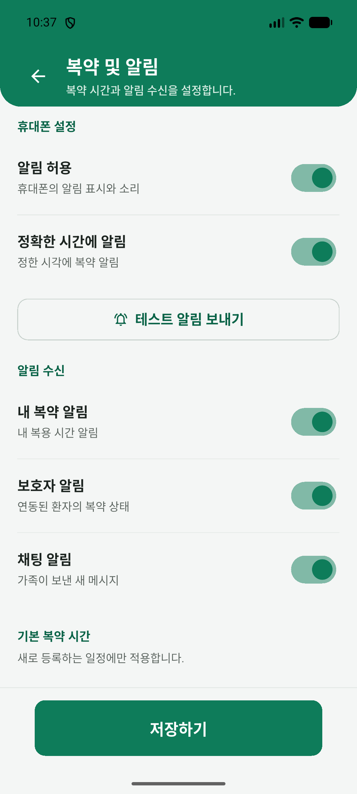

# MedBuddy 사용설명서

환자와 보호자를 위한 Android 앱 사용 안내입니다. 약 등록과 복약 기록부터 환자·보호자 연결, 가족 채팅, 위젯, 병원·약국 찾기와 환경설정까지 이용 순서대로 설명합니다.

앱 버전: 0.2.4 (개발 브랜치, 2026-10-22 기준)

[캡처가 포함된 사용설명서 PDF](MedBuddy_User_Guide_ko.pdf)

본문은 GitHub에서 바로 읽을 수 있습니다. 각 소섹션의 PDF 링크에서 화면을 확인하고 단계 번호 순서대로 진행하세요. 사진 안의 빨간 번호는 단계 아래 번호 목록과 대응합니다.

PDF 오른쪽 아래에는 현재 소섹션 번호와 제목이 표시됩니다. 참고는 각 대섹션 끝에 모았으며, 소섹션 번호·페이지·사진 번호 링크를 누르면 관련 화면으로 이동합니다. 사진 번호는 본문의 단계 번호입니다.

**안내:** 설명서의 약과 용량은 조작 예시입니다. 실제 복용은 처방과 복약지도에 따르세요. 완료 표시는 사용자가 남긴 기록입니다.

**화면 출처:** 2026-10-22의 0.2.4 로컬 작업본과 대조해 채팅 기록 공유·통합 알림 설정·위젯 추가 경로를 반영했습니다. 월간 기록·공유창·채팅 카드·읽기 전용 기록·환경설정은 이미 제공된 2026-10-22 캡처를 사용했습니다. 그 밖에는 검수된 0.2.1·0.2.3 캡처를 재사용하며 이전 문구·배치가 일부 남아 있습니다. 같은 날의 캡처도 예시 약·날짜·횟수가 다르며 연속 조작 결과나 권장 복용량을 뜻하지 않습니다. 일부 기존 입력·확인 화면은 분리된 제품 위젯 예시입니다. 이번 문서 갱신에서는 에뮬레이터 조작·앱 빌드·계정 초기화·실제 AI 요청·새 공유 전송을 하지 않았습니다. 정식 출시 안내가 아닌 개발 브랜치 설명서입니다.

**2026-10-22 변경:** 복약 기록은 연결된 앱 채팅 또는 CSV로 공유할 수 있습니다. 채팅 카드의 공유 당시 건수와 ‘최신 기록 보기’의 현재 기록은 구분하세요. 별도의 사용 준비 점검 화면은 없어지고, 환경설정 → 복약 및 알림의 맨 위 휴대폰 설정에 권한 스위치와 테스트 알림을 통합했습니다. 휴대폰 권한 → 받을 알림 종류 → 기본 복약 시간 → 알림 공개 범위 순서로 확인하세요. 위젯 추가는 화면 및 음성 → 홈 화면에 있습니다. 본문과 PDF를 함께 갱신했습니다.

## 차례

- [1 시작하기](#chapter-1)
  - [1.1 처음 사용할 언어 선택하기](#section-1-1)
  - [1.2 이메일로 로그인하기](#section-1-2)
  - [1.3 가입하고 이메일 인증하기](#section-1-3)
  - [1.4 다른 방법으로 시작하기](#section-1-4)
  - [1.5 비밀번호 다시 설정하기](#section-1-5)
  - [1.6 홈과 주요 메뉴 익히기](#section-1-6)
- [2 약 등록과 식별](#chapter-2)
  - [2.1 처방전 사진 가져오기](#section-2-1)
  - [2.2 인식한 내용을 확인하고 수정하기](#section-2-2)
  - [2.3 미확인 약과 후보 확인하기](#section-2-3)
  - [2.4 이전 처방과 비교하기](#section-2-4)
  - [2.5 분석한 약 저장하기](#section-2-5)
  - [2.6 약 정보 직접 입력하기](#section-2-6)
  - [2.7 한 장에 찍힌 여러 알약 찾기](#section-2-7)
  - [2.8 알약마다 앞뒷면 사진 넣기](#section-2-8)
  - [2.9 알약 후보를 비교하고 다시 확인하기](#section-2-9)
  - [2.10 선택한 알약 저장하기](#section-2-10)
  - [2.11 필요할 때 복용하는 약 등록하기](#section-2-11)
- [3 오늘의 복약 기록](#chapter-3)
  - [3.1 홈에서 오늘 일정 확인하기](#section-3-1)
  - [3.2 홈에서 완료와 취소 기록하기](#section-3-2)
  - [3.3 전체 일정에서 약별로 기록하기](#section-3-3)
  - [3.4 시간대 전체 기록하기](#section-3-4)
  - [3.5 일정별 알림 시간 설정하기](#section-3-5)
  - [3.6 연결이 끊겼을 때 기록 확인하기](#section-3-6)
  - [3.7 날짜별 복약 기록 확인하기](#section-3-7)
  - [3.8 복용 상태와 기록 수정하기](#section-3-8)
  - [3.9 필요시 복용 내역 남기기](#section-3-9)
  - [3.10 복약 기록을 채팅 또는 CSV로 공유하기](#section-3-10)
- [4 환자와 보호자 연결](#chapter-4)
  - [4.1 환자가 연동 코드 만들기](#section-4-1)
  - [4.2 보호자가 환자 등록하기](#section-4-2)
  - [4.3 연동된 가족 확인하기](#section-4-3)
  - [4.4 환자의 홈과 전체 일정 확인하기](#section-4-4)
  - [4.5 가족의 표시 이름 바꾸기](#section-4-5)
  - [4.6 연동 해제하기](#section-4-6)
- [5 가족 채팅과 알림](#chapter-5)
  - [5.1 가족과 대화 열기](#section-5-1)
  - [5.2 대화할 약 선택하기](#section-5-2)
  - [5.3 메시지와 복약 확인 요청 보내기](#section-5-3)
  - [5.4 복용 상태와 불편함 알리기](#section-5-4)
  - [5.5 약 부족을 알리고 병원·약국 정보 공유하기](#section-5-5)
  - [5.6 메시지 삭제하고 대화 정리하기](#section-5-6)
  - [5.7 보호자 복약 알림 설정하기](#section-5-7)
  - [5.8 알림함 확인하고 정리하기](#section-5-8)
- [6 위젯 사용하기](#chapter-6)
  - [6.1 내 복약 위젯 추가하고 사용하기](#section-6-1)
  - [6.2 보호자 위젯에서 환자 일정 보기](#section-6-2)
  - [6.3 로그아웃된 위젯에서 다시 로그인하기](#section-6-3)
- [7 복약함과 건강 정보](#chapter-7)
  - [7.1 저장한 약 찾아보기](#section-7-1)
  - [7.2 조회 조건과 정렬 바꾸기](#section-7-2)
  - [7.3 복용이 끝난 약 확인하기](#section-7-3)
  - [7.4 약 상세정보와 사진 보기](#section-7-4)
  - [7.5 약 안내를 음성으로 듣기](#section-7-5)
  - [7.6 약 삭제하기](#section-7-6)
  - [7.7 건강 관리 추천 보기](#section-7-7)
  - [7.8 건강 관리 추천이 나오지 않을 때](#section-7-8)
  - [7.9 약 정보 수정과 처방 교체](#section-7-9)
  - [7.10 처방에 따른 복용 중단 기록하기](#section-7-10)
- [8 근처 병원·약국 찾기](#chapter-8)
  - [8.1 병원과 약국 선택하기](#section-8-1)
  - [8.2 진료과목으로 병원 찾기](#section-8-2)
  - [8.3 병원 조회 조건과 날짜 바꾸기](#section-8-3)
  - [8.4 병원 목록과 상세 정보 보기](#section-8-4)
  - [8.5 병원 즐겨찾기와 방문 준비](#section-8-5)
  - [8.6 주변 약국 조회하기](#section-8-6)
  - [8.7 약국 조회 조건과 날짜 바꾸기](#section-8-7)
  - [8.8 약국 목록과 상세 정보 보기](#section-8-8)
  - [8.9 약국 즐겨찾기](#section-8-9)
  - [8.10 약국 전화와 길찾기](#section-8-10)
- [9 환경설정과 계정 관리](#chapter-9)
  - [9.1 설정 메뉴와 저장·변경 취소](#section-9-1)
  - [9.2 글자 크기 바꾸기](#section-9-2)
  - [9.3 읽기 속도와 음성 미리보기](#section-9-3)
  - [9.4 언어와 시간 표시 바꾸기](#section-9-4)
  - [9.5 홈에 표시할 일정 선택하기](#section-9-5)
  - [9.6 받을 알림 고르기](#section-9-6)
  - [9.7 기본 복약 시간 바꾸기](#section-9-7)
  - [9.8 알림에 표시할 내용 정하기](#section-9-8)
  - [9.9 휴대폰 알림 설정과 위젯 추가 열기](#section-9-9)
  - [9.10 로그아웃하기](#section-9-10)
  - [9.11 계정 데이터 삭제하기](#section-9-11)
  - [9.12 휴대폰 알림 확인과 테스트하기](#section-9-12)
  - [9.13 데이터 이용과 삭제 범위 확인하기](#section-9-13)
- [10 문제 해결](#chapter-10)
  - [10.1 로그인 입력과 연결 오류 확인하기](#section-10-1)
  - [10.2 처방전 촬영과 분석 문제 해결하기](#section-10-2)
  - [10.3 알약 후보가 없거나 분석에 실패했을 때](#section-10-3)
  - [10.4 알림이 오지 않을 때](#section-10-4)
  - [10.5 기록이나 위젯이 늦게 바뀔 때](#section-10-5)
  - [10.6 병원·약국 결과를 다시 확인할 때](#section-10-6)

## 1 시작하기

### 1.1 처음 사용할 언어 선택하기

[소섹션: PDF 5쪽](MedBuddy_User_Guide_ko.pdf#page=5)

[화면 예시: PDF 6쪽](MedBuddy_User_Guide_ko.pdf#page=6)

#### 1. 언어 선택 열기

로그인 전에 언어를 바꾸려면 오른쪽 위 지구본을 눌러 언어 / Language 선택창을 여세요. 한국어와 English 중 선택할 수 있습니다.

#### 2. 한국어 선택

‘한국어’를 선택하면 창이 닫히고 로그인·가입·이메일 인증 안내가 한국어로 표시됩니다. 선택한 언어는 기기에 저장됩니다.

### 1.2 이메일로 로그인하기

[소섹션: PDF 7쪽](MedBuddy_User_Guide_ko.pdf#page=7)

[화면 예시: PDF 8쪽](MedBuddy_User_Guide_ko.pdf#page=8)

#### 1. 이메일 로그인

인터넷에 연결한 뒤 가입한 이메일과 비밀번호를 입력하고 ‘로그인’을 누르세요. 이메일 인증을 마친 계정은 홈으로 이동합니다. 사진은 입력 전 로그인 화면입니다.

### 1.3 가입하고 이메일 인증하기

[소섹션: PDF 9쪽](MedBuddy_User_Guide_ko.pdf#page=9)

[화면 예시: PDF 10쪽](MedBuddy_User_Guide_ko.pdf#page=10)

#### 1. 회원가입 열기

‘MedBuddy가 처음이신가요? 회원가입’을 눌러 ‘안전한 계정 만들기’ 화면을 여세요. 환자와 보호자 모두 같은 방법으로 가입하며, 가입 중 역할을 고르는 화면은 없습니다.

#### 2. 가입 정보 입력

사용할 이메일과 6자 이상의 비밀번호를 입력하고 ‘회원가입’을 누르세요. 입력 오류 안내가 있으면 먼저 고칩니다. 환자와 보호자는 각자 다른 계정으로 가입합니다.

#### 3. 받는 주소와 인증 메일 확인

화면에 표시된 이메일 주소의 메일함에서 인증 메일을 여세요. 메일이 없으면 주소·스팸함을 확인한 뒤 ‘인증 메일 다시 보내기’를 누릅니다.

#### 4. 인증 후 앱으로 돌아오기

받은 메일의 인증 링크를 누른 뒤 앱으로 돌아오세요. 인증을 확인하면 자동으로 로그인합니다. 이메일 인증 화면은 완료 전 안내이므로 이 화면에 머문다면 인증 상태를 다시 확인하세요.

[화면 예시: PDF 11쪽](MedBuddy_User_Guide_ko.pdf#page=11)

#### 5. 인증 상태 다시 확인

메일 인증을 마쳤는데 자동으로 넘어가지 않으면 ‘인증 상태 다시 확인’을 누르세요. 다른 계정을 쓰려면 왼쪽 위 뒤로가기로 로그인 화면에 돌아갑니다.

#### 6. 인증한 계정으로 시작

인증을 마치고 로그인하면 홈이 열립니다. 처음에는 복약 일정 없음이 표시될 수 있습니다. 약 등록·식별에서 자신의 약을 등록한 뒤 일정을 확인하세요.

### 1.4 다른 방법으로 시작하기

[소섹션: PDF 12쪽](MedBuddy_User_Guide_ko.pdf#page=12)

[화면 예시: PDF 13쪽](MedBuddy_User_Guide_ko.pdf#page=13)

#### 1. Google 로그인 시작

인터넷 연결을 확인하고 로그인 화면의 ‘Google로 계속하기’를 누르세요. MedBuddy의 이메일 로그인 칸에는 Google 비밀번호를 입력하지 마세요.

#### 2. Google 계정 선택과 인증

Google 안내가 나오면 사용할 계정을 확인하고 인증을 진행하세요. 취소하면 로그인되지 않습니다. 사진은 Google 안내가 아닌 MedBuddy의 진입 버튼입니다. 오류가 나면 연결을 확인하고 여기서 다시 시도하세요.

#### 3. 게스트 시작

로그인 화면에서 ‘회원가입 없이 계속하기’를 눌러 게스트 이용 안내를 여세요.

#### 4. 게스트 이용 전 확인

임시 계정의 제한을 읽고 이용하려면 계속을 누르세요. 취소하면 로그인 화면에 남습니다. 게스트 자료를 다른 계정으로 자동 이전하는 절차는 제공되지 않습니다.

[화면 예시: PDF 14쪽](MedBuddy_User_Guide_ko.pdf#page=14)

#### 5. 게스트 계정 확인

환경설정 → 계정에서 게스트 계정으로 사용 중인지 확인하세요. 게스트 로그아웃은 자료를 삭제하므로 계속 사용할 정보가 있으면 주의하세요.

### 1.5 비밀번호 다시 설정하기

[소섹션: PDF 15쪽](MedBuddy_User_Guide_ko.pdf#page=15)

[화면 예시: PDF 16쪽](MedBuddy_User_Guide_ko.pdf#page=16)

#### 1. 재설정 메일 요청

이메일·비밀번호로 가입했고 해당 메일함을 열 수 있는 계정에서 사용하세요. 가입한 이메일을 입력하고 ‘비밀번호 찾기’를 누르세요. 현재 비밀번호는 필요 없습니다.

#### 2. 재설정 안내 확인

로그인 화면에 이메일을 입력하고 비밀번호 찾기를 누르세요. 아래에 메일 발송 안내가 나오면 메일함의 재설정 링크를 이용합니다. 별도의 앱 내 재설정 페이지는 없습니다.

#### 3. 새 비밀번호로 로그인

메일함의 재설정 링크에서 새 비밀번호를 정한 뒤 앱으로 돌아와 로그인하세요. 이메일·비밀번호 계정용 절차이며 Google 계정 비밀번호는 바꾸지 않습니다.

### 1.6 홈과 주요 메뉴 익히기

[소섹션: PDF 17쪽](MedBuddy_User_Guide_ko.pdf#page=17)

[화면 예시: PDF 18쪽](MedBuddy_User_Guide_ko.pdf#page=18)

#### 1. 오늘의 기록 확인

홈 위쪽에서 오늘의 복약 진행률과 선택한 시간대의 약을 확인하세요. 앞의 숫자는 완료로 기록한 건수, 뒤의 숫자는 오늘 전체 건수입니다. 약이 등록된 시간대만 표시됩니다.

#### 2. 네 가지 바로가기

홈의 네 가지 바로가기에서 약 등록·식별, 건강 관리 추천, 근처 운영 병원·약국, 환경설정을 여세요. 테스트 알림은 환경설정 → 복약 및 알림 → 휴대폰 설정에 있습니다. 보호자 계정이 ‘내 일정’을 보고 있고 연동된 환자가 있으면 바로가기 아래에 ‘연동된 환자 일정 보기’가 나옵니다. 누르면 환경설정 → 화면 및 음성이 열리며, ‘홈 복약 일정’을 ‘연동된 환자’로 바꾸면 홈에 환자의 오늘 일정이 표시됩니다.

#### 3. 일정에서 오늘 기록하기

하단 ‘일정’을 눌러 내 계정의 오늘 약을 시간대별로 확인하고 복용 기록을 남기세요.

#### 4. 복약함에서 저장한 약 찾기

하단 ‘복약함’을 눌러 저장된 약을 검색하고 약 이름·복용 기간·상세정보를 확인하거나 정리하세요.

[화면 예시: PDF 19쪽](MedBuddy_User_Guide_ko.pdf#page=19)

#### 5. 채팅에서 가족과 대화하기

하단 ‘채팅’을 눌러 연결된 가족과 대화하세요. 환자·보호자 연결이 있어야 채팅 탭이 표시되며, 없으면 ‘내 정보’에서 먼저 연결하세요.

#### 6. 내 정보에서 계정과 연결 관리

하단 ‘내 정보’를 눌러 계정과 환자·보호자 연결을 확인하세요. 연결 전 하단 메뉴는 4개이며, 연결 후에는 복약함과 내 정보 사이에 채팅이 추가되어 5개가 됩니다.

#### 7. 계정과 가족 연결

‘내 정보’에서 로그인한 계정을 확인하고 ‘환자/보호자 연동’을 눌러 가족 연결 화면을 여세요. 게스트로 이용 중이면 ‘게스트 계정’으로 표시됩니다.

1. 복약 정보가 연결된 계정
2. 가족 연결과 환자 복약 상태

#### 8. 환경설정 메뉴 선택

홈의 환경설정 카드 또는 내 정보의 환경설정을 여세요. 복약 및 알림에는 알림 스위치와 휴대폰 알림 권한·테스트가, 계정의 개인정보 및 데이터에는 데이터 이용 안내가 있습니다. 화면 및 음성에서는 표시·읽기 설정을 관리합니다.

### 참고

**[1.1 - 6페이지 - 1~2번 사진](MedBuddy_User_Guide_ko.pdf#page=6)**

영어를 쓰려면 ‘English’를 선택하세요. 선택한 언어는 기기에 저장됩니다. 선택하지 않고 창만 닫으면 이전 언어를 유지합니다. 이 설명서는 Android용 0.2.4 개발 작업본을 기준으로 합니다. 기록 공유와 통합 설정은 2026-10-22 캡처를 사용하며, 변경되지 않은 기능은 검수된 0.2.1·0.2.3 캡처를 재사용했습니다. 일부 입력·확인 화면은 실제 앱 화면을 분리된 테스트 환경에서 예시 자료로 띄운 것이며 AI 분석·저장 완료 사례는 아닙니다. 일부 문구·날짜·테스트 약·기기 모양은 실제 화면과 다를 수 있습니다. 사진은 조작 예시이며 권장 복용법이 아닙니다.

**[1.2 - 8페이지 - 1번 사진](MedBuddy_User_Guide_ko.pdf#page=8)**

로그인 뒤 하단 내 정보에서 현재 계정과 연결 메뉴를 확인하세요. 이메일 인증 안내가 남으면 메일의 링크로 인증한 뒤 앱으로 돌아오세요.

**[1.3 - 10페이지 - 1번 사진](MedBuddy_User_Guide_ko.pdf#page=10)**

메일 인증 후 앱으로 돌아오면 인증 상태를 확인해 로그인합니다. 자동으로 넘어가지 않으면 인증 상태 다시 확인을 누르세요. 메일이 없으면 주소와 스팸함을 확인하고 다시 보내세요.

**[1.4 - 13페이지 - 1번 사진](MedBuddy_User_Guide_ko.pdf#page=13)**

게스트 이용 전 임시 계정의 제한을 읽고 계속할지 정하세요. 게스트 로그아웃은 해당 데이터를 영구 삭제하므로 계속 사용할 자료가 있다면 주의하세요. Google 인증 화면과 계정 선택은 기기·계정 상태에 따라 달라집니다.

**[1.5 - 16페이지 - 1번 사진](MedBuddy_User_Guide_ko.pdf#page=16)**

로그인 화면에 이메일을 입력하고 비밀번호 찾기를 누르면 재설정 메일 요청 결과가 화면 아래에 표시됩니다. 별도 재설정 페이지는 없습니다. 요청 안내는 메일 수신이나 비밀번호 변경 완료를 뜻하지 않습니다. 메일함과 스팸함에서 링크를 확인해 새 비밀번호를 정한 뒤 앱으로 돌아와 로그인하세요. 이메일·비밀번호 계정용 절차이며 Google 계정 비밀번호는 바꾸지 않습니다.

**[1.6 - 18페이지 - 1~2번 사진](MedBuddy_User_Guide_ko.pdf#page=18)**

홈에 내 일정과 환자 일정 중 무엇을 띄울지는 환경설정에서 바꿉니다. 환자·보호자는 연결 관계에 따른 구분이며, 보호자도 본인 약을 등록해 관리할 수 있습니다. 요약에는 약이 등록된 시간대만 표시됩니다. 점은 현재 시간대의 위치를 보여 주며, 좌우로 밀어 다른 시간대를 봅니다.

**[1.6 - 18페이지 - 3~4번 사진](MedBuddy_User_Guide_ko.pdf#page=18) / [1.6 - 19페이지 - 5~6번 사진](MedBuddy_User_Guide_ko.pdf#page=19)**

채팅이 없으면 내 정보에서 환자·보호자 연동을 먼저 진행하세요. 다른 화면에서 왼쪽 위 뒤로가기 화살표를 누르면 이전 화면으로 돌아갑니다. 설정값을 바꾼 경우에는 저장 여부를 묻는 창이 나올 수 있습니다.

**[1.6 - 19페이지 - 7~8번 사진](MedBuddy_User_Guide_ko.pdf#page=19)**

‘내 정보’에는 내 이메일이나 이름을 직접 고치는 입력칸이 없습니다. 가족의 ‘표시 이름’은 내 화면에서 상대를 알아보기 위한 별칭입니다. 이전 화면으로 돌아갈 때는 위쪽 뒤로가기 화살표를 누르세요.

## 2 약 등록과 식별

### 2.1 처방전 사진 가져오기

[소섹션: PDF 22쪽](MedBuddy_User_Guide_ko.pdf#page=22)

[화면 예시: PDF 23쪽](MedBuddy_User_Guide_ko.pdf#page=23)

#### 1. 처방전 분석 선택

홈의 ‘약 등록·식별’에서 ‘처방전 분석’을 눌러 처방전 사진을 가져올 방법을 선택하세요.

#### 2. 사진 출처 선택

새 처방전을 찍으려면 ‘카메라로 촬영’, 저장된 사진을 가져오려면 ‘갤러리에서 선택’을 누르세요. 사진 선택만으로 약이 저장되지는 않습니다.

#### 3. 갤러리 열기

사진 출처에서 ‘갤러리에서 선택’을 눌러 기기의 사진 선택기를 여세요. 선택기의 이름과 배치는 기기마다 다를 수 있습니다.

#### 4. 처방전 사진 선택

사진 선택기에서 처방전 사진 한 장을 고르고 완료 버튼을 누르세요. 사진은 가상 처방전 한 장을 선택한 예시이며 ‘Done’으로 가져옵니다. 선택기의 이름과 배치는 기기에 따라 다를 수 있습니다.

### 2.2 인식한 내용을 확인하고 수정하기

[소섹션: PDF 24쪽](MedBuddy_User_Guide_ko.pdf#page=24)

[화면 예시: PDF 25쪽](MedBuddy_User_Guide_ko.pdf#page=25)

#### 1. 인식 결과 검토

검토 표의 약 이름·함량을 원본 처방전과 대조하세요. 검토 필요가 표시된 행도 직접 확인해야 합니다. 표를 옆으로 밀면 복용 정보가 더 보입니다. 이 화면은 분석과 저장을 마친 상태가 아닙니다.

#### 2. 원본 사진 확인

위의 원본 사진과 인식 내용을 대조하세요. 사진의 확대 아이콘을 누르면 더 크게 볼 수 있습니다. 초록색은 약품 정보 인식 영역, 회색은 개인정보 마스킹 영역입니다. 민감한 정보가 남아 있지 않은지도 확인하세요.

#### 3. 복용 정보 수정

표에서 수정할 값을 누르고 이름·조제일자·1회 투약량·복용 유형·횟수·총 투약일을 원본과 대조하세요. 정기 복용인지 필요시 복용인지도 확인합니다. 시간대를 고르는 것과 복용하는 날을 정하는 것은 다릅니다.

#### 4. 매일이 아닌 복용 지시 확인

주 1회·격일 등은 원본 지시와 대조하세요. 사진은 주 1회·총 56일일 때 8일 복용으로 안내되는 예시입니다. 매일 1회와 다르며, 시간대 선택만으로 복용하는 날이 바뀌지는 않습니다.

[화면 예시: PDF 26쪽](MedBuddy_User_Guide_ko.pdf#page=26)

#### 5. 조제일자 달력 선택

조제일자 옆 달력에서 필요한 월과 날짜를 고르세요. 위쪽 선택 날짜를 확인한 뒤 확인을 누릅니다. 사진은 10월 6일 선택 예시입니다. 수정창으로 돌아가 적용해야 표에 반영됩니다.

1. 선택한 날짜
2. 수정창으로 확인

#### 6. 수정 내용 적용 또는 취소

수정한 값과 실제 복약 시간대를 확인한 뒤 적용을 누르세요. 매일 복용하지 않는 약은 아래 복용일 안내도 읽습니다. 취소는 변경을 버리며, 적용만으로 복약함에 저장되지는 않습니다.

#### 7. 누락된 약 추가

원본 처방전에 있지만 표에 없는 약은 누락된 약 추가를 눌러 이름과 복용 정보를 입력하세요. 추가된 행도 원본과 대조합니다. 같은 제품이 여러 행이면 중복인지 서로 다른 일정인지 확인하세요.

#### 8. 검토 후 분석

약 이름·함량·복용량·횟수·기간·시간대를 원본과 대조한 뒤 검토 후 분석하기를 누르세요. 검토한 약의 제품 정보 조회와 분석을 시작합니다. 이 버튼은 복약함에 저장하는 버튼이 아닙니다.

### 2.3 미확인 약과 후보 확인하기

[소섹션: PDF 27쪽](MedBuddy_User_Guide_ko.pdf#page=27)

[화면 예시: PDF 28쪽](MedBuddy_User_Guide_ko.pdf#page=28)

#### 1. 미확인 약 이름 점검

‘검토 필요’로 표시된 약 이름과 함량을 원본과 대조하세요. 이 예시는 한 약이 확인되었고 다른 약 1개는 확인이 필요합니다. 후보가 있으면 아래에서 직접 대조할 수 있습니다.

#### 2. 미확인 약 다시 조회

잘못 인식된 이름이나 함량은 해당 값을 눌러 고친 뒤 ‘미확인 약 다시 조회’를 누르세요. 조회 결과에 후보가 있으면 다음 단계에서 처방전과 비교합니다.

#### 3. 약품 후보 열기

후보가 있는 약은 표 아래 ‘약품 후보 확인’ 버튼을 누르세요. 이 버튼은 처방전의 해당 행에 연결됩니다.

#### 4. 이름·함량·제형 대조

창 위 처방전 약 이름과 후보의 전체 이름·함량·제형을 대조하세요. 후보를 고르기 전에는 이 약으로 확인이 비활성화됩니다. 하나만 보여도 자동으로 같은 약이라고 판단하지 말고 확실하지 않으면 취소하세요.

[화면 예시: PDF 29쪽](MedBuddy_User_Guide_ko.pdf#page=29)

#### 5. 맞는 후보 확정

처방전과 일치하는 후보를 고르면 이 약으로 확인이 활성화됩니다. 선택 내용을 다시 확인한 뒤 누르세요. 후보 확정은 제품 확인 단계이며 복약함 저장 완료가 아닙니다.

#### 6. 확인 후 결과 열기

분석을 마치면 약 수를 확인하고 결과 확인하기를 누르세요. 사진은 약 2개이며 아직 저장 전입니다. 요약의 7일을 모든 약의 기간으로 보지 말고 결과 카드마다 실제 복용 기간을 대조하세요.

#### 7. 대안: 확인된 약만 계속

미확인 약을 제외해야 하는 경우에는 ‘확인된 약만으로 계속’을 누르세요. 다음 확인 창에서 제외할 약을 반드시 확인합니다. 필요한 약을 확인 없이 제외하지 마세요. 사진은 이 버튼을 누르기 전입니다.

### 2.4 이전 처방과 비교하기

[소섹션: PDF 30쪽](MedBuddy_User_Guide_ko.pdf#page=30)

[화면 예시: PDF 31쪽](MedBuddy_User_Guide_ko.pdf#page=31)

#### 1. 이전 처방과 비교하기

처방 변화 레이더에서 비교 기준 날짜와 결과를 확인하세요. 사진은 10월 4일과 6일 처방 사이에 약품 구성·복약 일정의 달라진 점을 찾지 못한 예시입니다. 비교는 복용 시작·중단 지시가 아니므로 원본과 의료진 안내로 확인하세요.

### 2.5 분석한 약 저장하기

[소섹션: PDF 32쪽](MedBuddy_User_Guide_ko.pdf#page=32)

[화면 예시: PDF 33쪽](MedBuddy_User_Guide_ko.pdf#page=33)

#### 1. 분석 결과 열기

분석한 약 수를 확인한 뒤 ‘결과 확인하기’를 누르세요. 예시는 약 2개이며 아직 저장 전입니다. 요약의 7일을 모든 약의 기간으로 보지 말고 결과 카드마다 기간을 대조하세요.

#### 2. 제품과 일정 대조

각 약 카드의 이름·함량·1회 투약량·1일 횟수·총 투약일을 원본과 대조하세요. 예시의 두 약은 횟수와 기간이 서로 다릅니다. 원본과 다르면 저장하지 말고 다시 확인하세요.

#### 3. 전체 저장

모든 결과가 처방과 맞는지 확인한 뒤 화면 맨 아래 ‘전체 저장하기’를 눌러 검토한 약을 한꺼번에 저장하세요. 사진은 저장 버튼을 누르기 전입니다.

#### 4. 한 약만 저장

한 약만 저장하려면 이름과 복용 일정을 대조한 뒤 그 카드 오른쪽 위 저장 아이콘을 누르세요. 사진은 두 번째 약의 개별 저장 아이콘이 보이는 저장 전 상태입니다.

### 2.6 약 정보 직접 입력하기

[소섹션: PDF 34쪽](MedBuddy_User_Guide_ko.pdf#page=34)

[화면 예시: PDF 35쪽](MedBuddy_User_Guide_ko.pdf#page=35)

#### 1. 약 이름과 수량 입력

‘약 등록·식별’에서 ‘직접 등록’을 선택하고 약 이름과 1회 복용량의 수량을 입력하세요. 사진 없이도 등록할 수 있으며, 약 봉투나 복약 안내를 기준으로 입력하세요.

#### 2. 복용량 단위 선택

1회 복용량 오른쪽 단위를 누르고 정·캡슐·포·mL·방울 중 복약 안내에 맞는 항목을 고르세요. 사진은 목록을 열기 전이며 ‘정’이 선택되어 있습니다.

#### 3. 알약 사진 추가

사진을 붙이려면 ‘알약 사진’ 오른쪽의 사진 추가 아이콘을 누르세요. 사진은 선택 사항이며, 선택한 사진은 이 기기의 앱 내부에만 저장됩니다.

#### 4. 복용 기간 지정

시작일과 종료일을 각각 눌러 복용 기간을 지정하고, 두 날짜 아래에 표시되는 총 복용 일수를 확인하세요. 종료일은 시작일보다 앞설 수 없습니다.

[화면 예시: PDF 36쪽](MedBuddy_User_Guide_ko.pdf#page=36)

#### 5. 종료 날짜 선택

시작일이나 종료일을 눌러 연 달력에서 날짜를 고르고 오른쪽 아래 ‘확인’을 누르세요. 사진은 10월 10일이 선택된 예시입니다. ‘취소’는 이번 날짜 선택을 버립니다.

#### 6. 복용 기간 재확인

시작일·종료일과 총 일수를 다시 확인하세요. 정해진 일정에 복용하는 약은 복용 유형에서 정기 복용을 선택합니다. 처방에서 필요할 때만 복용하도록 안내한 약은 필요시 복용을 선택하세요.

#### 7. 복용 주기 선택

정기 복용이면 매일·격일·주 1회·월 1회 중 처방에 맞는 주기를 고르세요. 주 1회를 고르면 요일을 선택할 수 있습니다. 사진은 매일을 선택한 예시이며, 필요시 복용에는 정기 주기·시간대를 설정하지 않습니다.

#### 8. 복용 시간대 선택

아래로 내려 아침·점심·저녁·취침 전 중 실제 복용할 시간대를 모두 고르세요. 비매일 주기를 골랐다면 복용하는 날에만 이 시간대의 일정이 생깁니다. 처방·복약 안내에 맞춰 선택하세요.

[화면 예시: PDF 37쪽](MedBuddy_User_Guide_ko.pdf#page=37)

#### 9. 복약 정보 저장

약 이름·1회량·기간·복용 유형을 확인하고 정기 복용이면 주기·시간대도 확인한 뒤 복약 정보 저장을 누르세요. 사진은 저장 전 입력폼입니다. 저장 결과를 확인하고 복약함에서 등록된 약을 찾으세요.

#### 10. 빠진 약 이름 입력

이름을 비운 채 저장해 빨간 안내가 나타나면 약 이름을 입력한 뒤 다시 저장하세요.

### 2.7 한 장에 찍힌 여러 알약 찾기

[소섹션: PDF 38쪽](MedBuddy_User_Guide_ko.pdf#page=38)

[화면 예시: PDF 39쪽](MedBuddy_User_Guide_ko.pdf#page=39)

#### 1. 여러 알약 모드 선택

‘약 등록·식별 → 낱알약 식별’에서 ‘여러 알약 한 번에 찾기’를 고르세요. 서로 다른 알약을 한 사진에 놓고 번호별 후보를 확인하는 방식입니다.

#### 2. 한 장의 사진 추가

‘사진 추가’를 눌러 촬영하거나 갤러리에서 고르세요. 한 사진에는 알약을 최대 10개까지 겹치지 않게 놓습니다. 글자와 각인이 선명하게 보이도록 촬영하세요.

#### 3. 검출 번호와 후보 대조

사진 위 번호와 아래의 같은 번호 후보를 대조하세요. 이 예시는 같은 제품의 앞뒷면 사진이 두 영역으로 검출된 것으로, 서로 다른 약 두 종류를 확인한 사례가 아닙니다.

#### 4. 사진 교체 또는 영역 재분석

잘못된 사진은 ‘사진 변경’으로 바꾸세요. 특정 알약만 다시 확인하려면 해당 번호의 ‘영역 다시 분석’이나 ‘뒷면 추가’를 이용합니다.

### 2.8 알약마다 앞뒷면 사진 넣기

[소섹션: PDF 40쪽](MedBuddy_User_Guide_ko.pdf#page=40)

[화면 예시: PDF 41쪽](MedBuddy_User_Guide_ko.pdf#page=41)

#### 1. 같은 알약의 앞뒷면 추가

‘알약 하나씩 찾기’에서는 각 묶음의 앞면 사진이 필수이고 뒷면은 선택입니다. 사진칸을 눌러 촬영하거나 고르세요. 뒷면에는 반드시 같은 알약을 뒤집은 사진을 넣습니다.

#### 2. 사진 확인과 삭제

추가한 사진을 확인하세요. 다른 약이나 흐린 사진을 넣었다면 해당 사진칸의 X로 지운 뒤 다시 고릅니다. 사진을 바꾸면 그 사진에 대한 후보도 다시 확인해야 합니다.

#### 3. 알약 묶음 추가

다른 알약은 ‘알약 한 개 더 추가’로 별도 묶음에 넣으세요. 최대 10개까지 각각 준비할 수 있습니다. 분석할 모든 묶음에 앞면 사진이 있어야 합니다.

#### 4. 후보 찾기 시작

앞면을 모두 준비한 뒤 ‘알약 N개 후보 찾기’를 누르세요. 비교가 끝날 때까지 기다린 뒤 각 알약의 후보를 직접 확인합니다. 사진 추가나 분석 완료만으로 약이 저장되지는 않습니다.

### 2.9 알약 후보를 비교하고 다시 확인하기

[소섹션: PDF 42쪽](MedBuddy_User_Guide_ko.pdf#page=42)

[화면 예시: PDF 43쪽](MedBuddy_User_Guide_ko.pdf#page=43)

#### 1. 일치도 경고 확인

낮은 일치도나 사진 품질 경고가 있으면 앞뒷면·색·모양·각인을 다시 확인하세요. 첫 번째 후보가 정답이라는 뜻은 아닙니다. 확실하지 않은 약은 선택하거나 복용하지 말고 포장 정보와 약사에게 확인하세요.

#### 2. 대조한 후보 선택

제품명·함량·각인·사진을 비교한 뒤 맞는 후보의 원을 누르세요. 선택하면 초록 테두리와 선택 표시가 생깁니다. 사진은 8개 후보 중 첫 후보를 선택한 상태이며, 선택 자체가 정확성을 보증하지 않습니다.

#### 3. 비슷한 후보 더 보기

처음 보이는 후보에서 확신할 수 없다면 ‘비슷한 후보 더 보기’를 눌러 나머지 후보도 확인하세요. 같은 성분처럼 보여도 함량이나 제형이 다를 수 있습니다.

#### 4. 제품 정보를 비교

후보 목록에서 약 이름 전체와 제조사, 제품 각인을 비교하세요. 숫자나 이름이 비슷하다는 이유만으로 고르지 마세요. 화면의 목록은 식별을 돕는 후보이지 복용 가능한 약의 추천 목록이 아닙니다.

[화면 예시: PDF 44쪽](MedBuddy_User_Guide_ko.pdf#page=44)

#### 5. 해당 알약 다시 확인

여러 알약 모드에서는 확인할 번호의 ‘영역 다시 분석’을 누르거나 ‘뒷면 추가’로 같은 알약의 반대쪽을 보완하세요. 다른 번호의 알약 뒷면을 섞지 마세요.

#### 6. 사진 출처 선택

사진 선택창에서 ‘카메라로 촬영’ 또는 ‘갤러리에서 선택’을 고르세요. 앞면·뒷면 중 어느 사진칸에서 열었는지 확인하고 해당 면의 사진을 넣습니다.

### 2.10 선택한 알약 저장하기

[소섹션: PDF 45쪽](MedBuddy_User_Guide_ko.pdf#page=45)

[화면 예시: PDF 46쪽](MedBuddy_User_Guide_ko.pdf#page=46)

#### 1. 선택한 후보 검토

모든 알약의 후보를 확인한 뒤 아래 ‘선택한 후보 확인’을 누르세요. 여러 알약이면 선택한 개수가 표시될 수 있습니다. 다음 화면에서 실제 복용 일정을 확인해야 합니다.

#### 2. 임시 기본값 반드시 수정

사진만으로 실제 복용량과 기간을 알 수 없습니다. 사진의 1정·1회·1일·아침은 임시 기본값입니다. 처방전이나 약 봉투와 대조한 뒤 연필 모양 ‘복약 정보 수정’을 누르세요.

#### 3. 이름·시작일·복용량 입력

수정창에서 약 이름, 복용 시작일, 1회 복용량과 복용 유형을 확인하세요. 사진은 정기 복용 예시입니다. 날짜는 달력에서 고르며, 미리 채워진 값도 처방·복약 안내와 다르면 수정해야 합니다.

#### 4. 복용하는 날 선택

복용 주기에서 실제 지시를 고르세요. 사진은 아래로 내린 주 1회·총 56일 예시로, 8일 복용 안내가 보입니다. 알약 사진으로 복용법을 알 수는 없으므로 처방·복약 안내와 대조하세요.

[화면 예시: PDF 47쪽](MedBuddy_User_Guide_ko.pdf#page=47)

#### 5. 횟수·기간·시간대 적용

복용 주기, 복용하는 날의 횟수, 총 기간과 시간대를 맞춘 뒤 적용을 누르세요. 주 1회는 하루 한 번씩 매일 먹는다는 뜻이 아닙니다. 확실하지 않으면 취소하고 처방·복약 안내부터 확인하세요.

#### 6. 저장 전 일정 재확인

모든 약의 시작일·복용량·횟수·주기·총 기간·시간대를 다시 읽으세요. 수정하려면 연필을 누릅니다. 사진은 매일 복용 기본값 예시이며 실제 복용법이 아닙니다. 확인되지 않은 값으로 저장하지 마세요.

#### 7. 확인한 정보 저장

모든 정보가 처방·복약 안내와 일치할 때만 ‘확인하고 저장하기’를 누르세요. 처리 결과의 저장·기존 정보·실패 항목을 확인하고, 복약함에서 등록 내용을 다시 확인합니다.

### 2.11 필요할 때 복용하는 약 등록하기

[소섹션: PDF 48쪽](MedBuddy_User_Guide_ko.pdf#page=48)

[화면 예시: PDF 49쪽](MedBuddy_User_Guide_ko.pdf#page=49)

#### 1. 복용 유형 선택

약 등록·식별 → 직접 등록에서 약 이름·1회량·기간을 입력하고 복용 유형의 필요시 복용을 고르세요. 정해진 일정에 복용하는 약을 편의상 필요시로 바꾸지 마세요.

#### 2. 정기 일정과 구분

필요시 복용을 고르면 정기 복용 주기·시간대 대신 안내가 표시됩니다. 이 약은 정해진 시각의 복약 알림과 미복약 알림에서 제외되므로 안내를 읽고 저장하세요.

#### 3. 복약함에서 확인

저장 후 복약함에서 약 이름과 필요시 복용 표시를 확인하세요. 정기 시간대 대신 일정 아래쪽의 필요시 복용에 표시됩니다. 새 복용은 그곳의 약 왼쪽 동그라미로 기록하고, 기존 기록 정정은 복약 기록에서 합니다.

### 참고

**[2.1 - 23페이지 - 1번 사진](MedBuddy_User_Guide_ko.pdf#page=23)**

사진을 고르는 것만으로 약이 저장되지는 않습니다. 무료 Gemini 환경에서는 개인정보·민감정보를 AI에 전송해서는 안 됩니다. 실제 환자의 처방전으로 AI 기능을 이용하지 마세요. 기기에서 이름을 지웠더라도 모든 식별 정보가 제거된다고 보장할 수 없습니다. 이 설명서는 가상 테스트 자료를 사용합니다.

**[2.1 - 23페이지 - 2번 사진](MedBuddy_User_Guide_ko.pdf#page=23)**

사진을 고르는 것만으로 약이 저장되지는 않습니다.

**[2.1 - 23페이지 - 3~4번 사진](MedBuddy_User_Guide_ko.pdf#page=23)**

사진 선택기의 이름과 배치는 기기마다 다를 수 있습니다.

**[2.2 - 25페이지 - 1번 사진](MedBuddy_User_Guide_ko.pdf#page=25)**

인식 표를 가로로 밀어 복용 정보를 모두 확인하세요. 이름·함량·조제일자·복용량·횟수·총 기간·시간대를 원본과 대조합니다. 매일 복용하지 않는 약은 표의 매일 아님 표시와 수정창의 복용일 안내를 확인하세요. 주 1회·격일·요일 지시를 매일의 횟수로 바꾸지 마세요. 예를 들어 8주는 56일의 기간이며 8일이 아닙니다. 기간과 그 안에 실제 복용하는 날 수는 다릅니다. 주 단위 여러 회는 시작일을 기준으로 나뉠 수 있어 실제 요일 지시와 비교해야 합니다. 월 1회는 같은 달력 날짜가 아니라 30일 간격입니다. 필요시 복용은 자동 판단하지 않으므로 표시된 일정을 의료진·약사의 지시와 확인하세요. 누락된 약을 추가하거나 잘못된 행을 삭제해도 아직 저장된 것은 아닙니다. 수정창의 복용 유형에서 정기 복용과 필요시 복용을 구분합니다. 필요시 복용은 정기 일정·미복약 알림에서 제외됩니다. 수정창 사진은 현재 제품 화면을 네트워크가 차단된 가상 자료 환경에서 연 예시입니다.

**[2.3 - 28페이지 - 1번 사진](MedBuddy_User_Guide_ko.pdf#page=28)**

확인되지 않은 약을 제외하고 진행할 때는 제외 대상을 다시 확인하세요. 제외된 약은 분석 결과와 복약 일정에 들어가지 않습니다. 필요한 약을 놓치지 않도록 원본과 대조하고, 확실하지 않은 후보는 저장하지 마세요. 일부 후보의 정보 조회가 실패하면 확인 가능한 후보만 나올 수 있습니다. 한 개만 보인다고 유일한 제품이거나 자동 확정된 약이라는 뜻은 아닙니다. 처방전의 이름·함량·제형과 대조하고, 맞는 후보가 없으면 취소한 뒤 이름을 확인해 다시 조회하세요. 하루 사용 횟수를 모두 썼다는 안내이면 반복 요청하지 말고 안내된 다음 날에 다시 시도하세요.

**[2.4 - 31페이지 - 1번 사진](MedBuddy_User_Guide_ko.pdf#page=31)**

이전 처방과 비교가 제공되면 추가·유지·변경·빠진 약과 복용 일정 차이를 원본 처방전과 대조하세요. 관련 이전 처방이 없거나 일부 약을 제외한 경우에는 비교가 제공되지 않을 수 있습니다. 비교 결과는 복용을 시작하거나 중단하라는 지시가 아닙니다. 이름·함량·횟수·기간·시간대는 의료진의 안내를 기준으로 확인하세요. 2주와 14일처럼 뜻이 같은 기간은 단순 표기 차이만으로 변경 표시되지 않을 수 있습니다. 반대로 식전·식후·필요시 같은 지시가 추가되면 확인할 변화입니다. 비교 결과가 없더라도 원본 처방의 모든 복용 지시를 직접 대조하세요.

**[2.5 - 33페이지 - 1번 사진](MedBuddy_User_Guide_ko.pdf#page=33)**

저장 요청 후 처리 안내를 확인하고 복약함에서 약 이름과 복용 기간을 확인하세요. 개별 저장과 전체 저장은 선택한 범위가 다릅니다. 저장 완료 후 일정 조회가 실패해도 저장 자체가 실패했다고 단정하지 말고, 연결을 확인해 목록을 다시 여세요. 같은 약을 곧바로 중복 등록하지 마세요. 저장 가능한 약 개수에 도달했다는 안내이면 같은 요청을 반복하지 마세요. 복약함에서 이미 등록된 약을 먼저 확인하고, 기록이 삭제되는 범위를 이해한 경우에만 불필요한 항목을 정리하세요. 진행 중인 약을 한도 때문에 임의로 지우지 마세요.

**[2.6 - 35페이지 - 1번 사진](MedBuddy_User_Guide_ko.pdf#page=35)**

저장한 약은 하단 복약함에서 찾을 수 있습니다. 검색어·복용 상태·날짜 기준 때문에 약이 숨겨질 수 있으므로 목록 조건도 확인하세요. 등록된 복용 정보는 제품의 일반 복용 안내와 구분해 읽으세요. 빈 입력폼과 목록은 각각 조작 위치의 예시이며 같은 약을 연속 등록한 결과를 뜻하지 않습니다. 복용 주기에서는 매일·격일·주 1회·월 1회를 고릅니다. 시작일과 기간을 기준으로 복용하는 날 수가 안내되므로 저장 전에 확인하세요. 월 1회는 30일 간격입니다. 목록의 선택지로 처방의 실제 지시를 표현할 수 없다면 임의로 가까운 주기를 고르지 마세요. 저장된 약이 오늘 일정에 없으면 복약함에서 다음 복용일과 복용 기간을 먼저 확인합니다. 필요시 복용은 정기 복약 일정·미복약 알림에서 제외됩니다. 복용 판단과 간격·최대량은 처방·복약지도에 따르며, 앱이 복용을 권하거나 정하지 않습니다. 필요시 약의 새 복용은 일정 아래쪽 필요시 복용의 동그라미로 기록하고, 이미 남긴 기록의 정정은 복약 기록에서 합니다. 직접 등록과 처방 교체는 약 이름, 수량·단위, 시작일·종료일, 복용 유형·주기·시간대를 같은 형식으로 입력합니다. 처방 교체에는 기기 전용 사진 추가 항목이 없습니다.

**[2.7 - 39페이지 - 1번 사진](MedBuddy_User_Guide_ko.pdf#page=39)**

사진은 외부 AI로 분석됩니다. 후보만으로 약을 확정하지 말고 포장 정보와 대조하세요. 얼굴·신분증·환자 이름 등 불필요한 개인정보가 사진에 포함되지 않게 하세요. 무료 Gemini 환경에서는 개인정보·민감정보를 전송하면 안 되며, 실제 환자 정보가 포함된 AI 분석은 이용하지 마세요.

**[2.7 - 39페이지 - 2번 사진](MedBuddy_User_Guide_ko.pdf#page=39)**

사진은 외부 AI로 분석됩니다. 후보만으로 약을 확정하지 말고 포장 정보와 대조하세요.

**[2.7 - 39페이지 - 3~4번 사진](MedBuddy_User_Guide_ko.pdf#page=39)**

이 촬영 예시는 같은 제품의 앞뒷면이 담긴 사진입니다. 서로 다른 약 두 종류를 식별한 사례가 아닙니다.

**[2.8 - 41페이지 - 1~2번 사진](MedBuddy_User_Guide_ko.pdf#page=41)**

한 묶음에는 같은 알약의 앞면과 뒷면을 넣으세요. 앞면은 필수이고 뒷면은 선택 사항입니다.

**[2.8 - 41페이지 - 3~4번 사진](MedBuddy_User_Guide_ko.pdf#page=41)**

필요 없는 묶음은 해당 묶음 오른쪽 위 휴지통으로 삭제할 수 있습니다.

**[2.9 - 43페이지 - 1번 사진](MedBuddy_User_Guide_ko.pdf#page=43)**

후보 목록에서 이름·함량·제형·식별 표시를 실제 약과 대조하세요. 더 많은 후보가 있으면 목록을 내려 확인합니다. 후보 수와 일치도는 사진마다 달라지며 가장 위 후보가 정답이라는 보장은 없습니다. 후보를 누르면 상세를 검토할 수 있고 확인 전에는 복약함에 저장되지 않습니다. 확실하지 않은 약은 임의로 선택하거나 복용하지 마세요.

**[2.10 - 46페이지 - 1번 사진](MedBuddy_User_Guide_ko.pdf#page=46)**

사진만으로 복용량과 기간을 알 수 없습니다. 임시 기본값을 처방전·약 봉투와 대조해 수정하세요. 여러 사진에서 같은 제품을 고르면 중복 처리 안내가 나타날 수 있습니다. 별도로 유지하거나 같은 일정만 묶는 방식을 검토하며, 복용량·날짜·기간이 다르면 별도로 유지됩니다. 이 선택만으로 저장되지는 않습니다. 저장 후 성공·기존 정보·실패 항목을 확인하고 복약함에서 등록 내용을 확인하세요. 알약 사진만으로 복용하는 날도 알 수 없습니다. 수정창의 복용 주기를 처방·복약 안내에 맞게 고르세요. 주기와 별개로 복용하는 날의 횟수·시간대를 정하고, 총 기간 안의 복용일 수를 확인합니다. 월 1회는 30일 간격입니다. 복용 유형도 처방·복약 안내와 대조하세요. 필요시 복용은 정기 주기·시간대 대신 별도로 기록합니다. 검토·수정창 사진은 현재 제품 화면을 네트워크가 차단된 가상 자료 환경에서 연 예시이며, 실제 AI 식별이나 서버 저장 완료 화면이 아닙니다.

**[2.11 - 49페이지 - 1번 사진](MedBuddy_User_Guide_ko.pdf#page=49)**

이 기능은 처방에서 필요할 때 복용하도록 안내한 약을 기록하는 용도입니다. 앱은 복용 여부·간격·최대량을 판단하지 않습니다. 사진은 미저장 입력폼이며 실제 복용이나 등록 완료를 뜻하지 않습니다.

## 3 오늘의 복약 기록

### 3.1 홈에서 오늘 일정 확인하기

[소섹션: PDF 53쪽](MedBuddy_User_Guide_ko.pdf#page=53)

[화면 예시: PDF 54쪽](MedBuddy_User_Guide_ko.pdf#page=54)

#### 1. 오늘 기록의 진행률

오늘의 복약 진행률을 확인하세요. 앞의 숫자는 완료로 기록한 건수, 뒤의 숫자는 오늘 전체 건수입니다. 같은 약도 시간대가 다르면 별도 기록으로 계산됩니다.

#### 2. 선택한 시간대 확인

현재 선택된 시간대의 요약을 확인한 뒤 요약 영역을 왼쪽으로 밀어 다음 시간대로 이동하세요. 사진은 점심을 선택한 예시이며, 채워진 점은 현재 시간대를 나타냅니다. 전체 진행률과 해당 시간대의 상태를 구분하세요.

### 3.2 홈에서 완료와 취소 기록하기

[소섹션: PDF 55쪽](MedBuddy_User_Guide_ko.pdf#page=55)

[화면 예시: PDF 56쪽](MedBuddy_User_Guide_ko.pdf#page=56)

#### 1. 현재 시간대 기록

선택한 시간대의 약 이름을 확인한 뒤 실제로 모두 복용했을 때 ‘복용했어요’를 누르세요. 해당 시간대의 약이 함께 완료로 기록됩니다. 일부만 복용했다면 전체 일정에서 개별 체크하세요.

#### 2. 완료된 기록 확인

기록 후 진행률과 시간대의 완료 상태를 확인하세요. 예정 시각보다 30분 넘게 늦게 또는 두 시간 넘게 일찍 기록하면 저장 안내 뒤에 처방·복약지도를 확인하라는 주의 문구가 함께 나옵니다. 30분은 보호자 미복약 알림 전에 서버가 기다리는 시간과 같습니다. 사진은 아침 두 약이 모두 완료되어 2/2가 된 예시입니다. 다른 시간대가 있으면 이동해 따로 확인하세요. 화면 이동만으로 복용 완료가 되지는 않습니다.

#### 3. 시간대 전체 취소 확인

완료한 시간대에서 복용 완료 취소를 누르면 확인 창이 열립니다. 정말 그 시간대 전체 기록을 취소할 때만 복용 완료 취소를 선택하세요. 그대로 두기나 창 닫기는 기록을 유지합니다.

1. 완료 기록 유지
2. 해당 시간대 전체 취소

#### 4. 취소 후 기록 확인

취소를 확정하면 해당 시간대의 미복용 상태와 진행률을 확인하세요. 사진은 별도 일정의 취소 후 예시입니다. 취소는 앱의 기록만 되돌리며, 일부 약만 취소하려면 일정의 개별 체크를 사용하세요.

### 3.3 전체 일정에서 약별로 기록하기

[소섹션: PDF 57쪽](MedBuddy_User_Guide_ko.pdf#page=57)

[화면 예시: PDF 58쪽](MedBuddy_User_Guide_ko.pdf#page=58)

#### 1. 내 전체 일정 열기

하단 ‘일정’을 눌러 내 계정에 등록된 오늘의 약을 시간대별로 확인하세요. 연결된 환자의 일정은 보호자 홈이나 연동 목록에서 따로 여세요.

#### 2. 기록·상세정보·알림 구분

내 ‘일정’의 정기 복용 시간대에서 약 이름·1회량을 처방과 대조하세요. 왼쪽 원은 완료 기록, 약 이름은 상세정보, 종은 알림 설정입니다. 아래 필요시 복용의 원은 다른 방식으로 동작하므로 3.9를 확인하세요.

1. 원: 기록 / 약 이름: 상세
2. 종: 시간대 알림 설정

#### 3. 복용한 약만 기록

실제로 복용한 약 왼쪽의 빈 원을 누르세요. 선택한 약의 해당 시간대만 완료되며, 같은 시간대의 다른 약이나 다른 시간대 기록은 바뀌지 않습니다.

#### 4. 완료 상태와 실행 취소

체크 표시와 약 이름의 취소선으로 완료 상태를 확인하세요. 잘못 눌렀다면 완료 직후 아래에 잠깐 나타나는 ‘실행 취소’를 누르세요.

1. 체크와 취소선: 완료 기록
2. 잘못 눌렀을 때 실행 취소

[화면 예시: PDF 59쪽](MedBuddy_User_Guide_ko.pdf#page=59)

#### 5. 약 하나의 기록 취소

취소할 약의 체크 표시를 다시 누르면 해당 약의 그 시간대 기록만 해제됩니다. ‘실행 취소’ 안내가 사라진 뒤에도 사용할 수 있습니다.

#### 6. 아래쪽 일정 확인

일정 목록을 위로 밀어 저녁·취침 전 등 아래쪽 시간대를 보세요. 진행률과 하단 메뉴는 유지되고 목록만 움직입니다. 약이 예상과 다르면 복약함의 복용 기간과 등록 시간대를 확인하세요.

### 3.4 시간대 전체 기록하기

[소섹션: PDF 60쪽](MedBuddy_User_Guide_ko.pdf#page=60)

[화면 예시: PDF 61쪽](MedBuddy_User_Guide_ko.pdf#page=61)

#### 1. 시간대 전체 완료

아침 약을 모두 실제로 복용했다면 제목 오른쪽의 겹친 체크를 누르세요. 아침의 모든 약이 완료로 기록되며 점심·저녁 기록은 바뀌지 않습니다. 일부만 복용했다면 개별 체크하세요. 이미 모두 완료한 시간대에서 겹친 체크를 다시 누르면 홈과 같이 확인 창이 열리며, 복용 완료 취소를 골랐을 때만 그 시간대 전체 기록이 취소됩니다.

### 3.5 일정별 알림 시간 설정하기

[소섹션: PDF 62쪽](MedBuddy_User_Guide_ko.pdf#page=62)

[화면 예시: PDF 63쪽](MedBuddy_User_Guide_ko.pdf#page=63)

#### 1. 시간대 알림 설정 열기

오늘의 복약 일정에서 원하는 시간대 제목의 종을 누르세요. ‘아침 알림 설정’처럼 선택한 시간대의 설정창이 열립니다.

#### 2. 알림 사용과 시간 구분

알림 사용이 꺼져 있어도 알림 시간을 눌러 시각을 바꿀 수 있습니다. 시간을 바꾸는 것만으로 알림이 켜지지는 않습니다. 알림을 받으려면 사용 스위치를 켜고 저장하세요. 사진은 꺼짐 상태입니다.

1. 알림을 받을지 선택
2. 꺼짐 상태에서도 시간 편집

#### 3. 시·분 고르고 확인

시·분을 돌려 고르거나 선택된 숫자를 눌러 직접 입력하세요. 오른쪽 위 체크로 확인하면 원래 알림창으로 돌아갑니다. X로 닫으면 시간 선택을 취소합니다. 처방·복약 안내에 맞는 시간을 사용하세요.

1. 선택된 시·분
2. 알림창으로 적용

#### 4. 숫자로 시간 입력

시는 0~23, 분은 0~59로 입력하고 적용을 누릅니다. 사진은 시를 직접 입력하는 창입니다. 시간 선택창의 체크와 원래 알림창의 저장까지 눌러야 변경이 저장됩니다.

1. 시 숫자 입력
2. 입력값 적용

[화면 예시: PDF 64쪽](MedBuddy_User_Guide_ko.pdf#page=64)

#### 5. 시간과 사용 여부 저장

바뀐 시각과 알림 사용 여부를 확인하고 저장을 누릅니다. 사진은 꺼짐을 유지한 19:55 예시입니다. 저장 후 종을 다시 눌러 시간을 확인하세요. 꺼진 일정 카드에는 시각 대신 복약 알림 꺼짐이 표시됩니다.

1. 변경한 시각
2. 설정 최종 저장

### 3.6 연결이 끊겼을 때 기록 확인하기

[소섹션: PDF 65쪽](MedBuddy_User_Guide_ko.pdf#page=65)

[화면 예시: PDF 66쪽](MedBuddy_User_Guide_ko.pdf#page=66)

#### 1. 서버 전송 대기 확인

미리 불러온 정기 복약 일정은 인터넷이 끊겨도 확인하고 기록할 수 있으며, ‘전송 대기’가 표시될 수 있습니다. 보호자에게 아직 전달되지 않았을 수 있으니 같은 복용을 다시 입력하지 말고 전송 상태를 확인하세요. 처음 조회하거나 저장 기간이 지난 일정은 연결 후 다시 불러와야 합니다.

#### 2. 전송 대기 표시 다시 확인

연결이 돌아오면 전송 대기 표시가 사라지는지 확인하세요. 대기 목록에서 ‘서버에 모두 저장했습니다.’도 확인할 수 있습니다. 보호자 화면은 새로고침하고, 확인이 필요한 기록은 함부로 지우지 마세요.

### 3.7 날짜별 복약 기록 확인하기

[소섹션: PDF 67쪽](MedBuddy_User_Guide_ko.pdf#page=67)

[화면 예시: PDF 68쪽](MedBuddy_User_Guide_ko.pdf#page=68)

#### 1. 복용 기록 열기

아래 일정 메뉴를 열고 오른쪽 위 복용 기록 아이콘을 누르세요. 홈의 완료 버튼과 달리 날짜별 상태를 확인하고 수정하는 화면입니다. 화면은 이번 달 달력으로 열립니다. 날짜마다 정해진 복약 중 복용으로 기록한 수(예: 2/3)와 색 점이 표시됩니다. 초록은 모두 복용 기록, 주황은 일부 기록, 회색은 복용 기록 없음이며, 파란 고리는 그날 필요시 복용을 기록했다는 뜻입니다. 기록이 없다고 복용하지 않았다는 뜻은 아닙니다. 달력 위 화살표로 다른 달을 보고, 날짜를 누르면 그날의 자세한 기록이 열립니다. 하루 기록에서 날짜 왼쪽의 달력 버튼이나 휴대폰의 뒤로가기를 누르면 달력으로 돌아갑니다. 달력에서 내보내기를 누르면 보고 있는 달이 기본 기간으로 잡힙니다.

#### 2. 날짜 화살표로 하루씩 이동

하루 기록에서 가운데 날짜 양옆의 화살표로 이전·다음 날짜를 확인하세요. 오늘보다 미래이거나 최근 90일보다 이전인 날짜로는 이동할 수 없습니다. 가운데 날짜를 누르면 달력에서 하루를 직접 고를 수 있습니다.

#### 3. 중앙 날짜에서 달력 열기

가운데 날짜를 누른 뒤 달력에서 원하는 하루를 고르고 조회를 누르세요. 취소는 원래 날짜를 유지합니다. 여러 날짜를 내보낼 때는 이 달력 대신 내보내기 창의 시작일·종료일을 사용하세요.

#### 4. 상태와 기록 시각 확인

날짜 아래 복용함·건너뜀·미기록 수와 시간대별 내역을 확인하세요. 실제 복용 시각과 기록 시각은 다를 수 있습니다. 오른쪽 정보 버튼은 기록의 의미와 한국 시간 기준 안내를 엽니다. 실제 시각이 없는 예전 기록은 시각 미입력으로 표시됩니다.

[화면 예시: PDF 69쪽](MedBuddy_User_Guide_ko.pdf#page=69)

#### 5. 정보 버튼의 안내 읽기

상태별 건수 오른쪽 정보 버튼을 누르면 복약 기록 안내가 열립니다. 사용자의 보고라는 점, 미기록의 의미, 한국 시간 기준을 확인하고 닫기를 누르세요. 안내문은 목록 위에 계속 표시되지 않습니다.

#### 6. 보호자 읽기 전용 확인

보호자는 환자 일정의 복용 기록을 열어 제목 아래 ‘환자 기록 · 읽기 전용’을 확인하세요. 날짜 선택·새로고침·정보 확인·채팅 공유·CSV 내보내기는 가능하지만 기록 수정이나 새 복용 체크는 할 수 없습니다.

### 3.8 복용 상태와 기록 수정하기

[소섹션: PDF 70쪽](MedBuddy_User_Guide_ko.pdf#page=70)

[화면 예시: PDF 71쪽](MedBuddy_User_Guide_ko.pdf#page=71)

#### 1. 수정할 기록 선택

복약 기록에서 날짜·시간대와 약 이름을 확인하고 해당 행 오른쪽 연필 모양의 기록 수정을 누르세요. 정기 복용뿐 아니라 이미 남긴 필요시 복용 기록도 여기서 정정합니다. 보호자 읽기 전용 화면에는 수정 버튼이 없습니다.

#### 2. 상태와 이유 입력

실제 상황에 맞게 복용함·건너뜀·미기록 중 고르세요. 건너뜀을 고르면 선택적으로 이유를 적을 수 있습니다. 사진은 건너뜀 상태의 예시입니다.

#### 3. 확인 후 기록 저장

복용함을 선택했다면 실제 복용 시각도 확인하세요. 기록 저장을 누른 뒤 결과를 확인하고 목록에서 다시 읽으세요. 닫기는 입력을 저장하지 않습니다. 수정 내역은 이전 기록을 없애는 용도로 사용되지 않습니다.

### 3.9 필요시 복용 내역 남기기

[소섹션: PDF 72쪽](MedBuddy_User_Guide_ko.pdf#page=72)

[화면 예시: PDF 73쪽](MedBuddy_User_Guide_ko.pdf#page=73)

#### 1. 일정에서 필요시 약 체크

하단 일정에서 아래로 내려 필요시 복용을 찾으세요. 실제로 복용한 약 왼쪽 동그라미를 누르면 오늘의 새 복용이 기록됩니다. 복약 기록 화면에는 새 PRN 기록 버튼이 없으며 기존 내역만 확인·정정합니다.

#### 2. 필요시 약 일괄 체크

필요시 복용 제목 오른쪽 겹친 체크는 오늘 아직 기록하지 않은 약들을 각각 1회로 기록합니다. 모두 이미 체크돼 있으면 각 약의 추가 횟수 확인창이 열립니다. 표시된 대상 약을 모두 실제로 복용한 경우에만 사용하세요.

#### 3. 두 번째부터 추가 횟수 확인

이미 오늘 기록한 약을 다시 체크하면 추가 복용 기록 확인창이 열립니다. 약 이름과 ‘오늘 몇 회 → 몇 회’를 확인하세요. 실제 추가 복용이 맞을 때만 기록을 누르고, 중복 조작이면 취소합니다. 사진은 여러 차례 조작한 데모 예시입니다.

#### 4. 기존 필요시 기록 정정

복약 기록의 필요시 복용 구역에서 각 내역의 실제 복용·기록 시각을 복용한 순서대로 확인하세요. 잘못 누른 기록은 기록 직후 화면 아래 알림의 실행 취소로 바로 되돌릴 수 있습니다. 알림이 사라진 뒤에는 해당 행의 연필에서 기록 취소(잘못 기록함)를 고르세요. 보호자에게 이미 간 알림은 회수되지 않지만 보호자 화면의 횟수는 다시 조회하면 바로잡힙니다. 일정의 동그라미를 다시 누르는 것은 기록 취소가 아니라 새 복용을 추가하는 동작입니다.

[화면 예시: PDF 74쪽](MedBuddy_User_Guide_ko.pdf#page=74)

#### 5. 원할 때만 확인 알림 켜기

필요시 복용 제목의 종을 누르고 확인 알림을 켠 뒤 시각을 골라 저장하세요. 선택한 다음 시각에 한 번만 알려주며 기본은 꺼짐입니다. 정기 복약 알림·미복용 경고·반복 알림이 아니며 복용을 지시하지 않습니다.

### 3.10 복약 기록을 채팅 또는 CSV로 공유하기

[소섹션: PDF 75쪽](MedBuddy_User_Guide_ko.pdf#page=75)

[화면 예시: PDF 76쪽](MedBuddy_User_Guide_ko.pdf#page=76)

#### 1. 내보내기 열기

복약 기록 오른쪽 위 내보내기 아이콘을 누르세요. 조회 화면과 별도로 공유할 기간을 정하는 작은 창이 열립니다. 월간 달력에서는 조회 중인 달의 확인 가능한 기간, 날짜별 화면에서는 그 날짜가 시작일·종료일의 초기값입니다.

#### 2. 시작일과 종료일 각각 선택

공유 창의 시작일과 종료일을 각각 눌러 날짜를 고르세요. 최근 90일 중 최대 31일만 가능하며 종료일은 시작일보다 빠를 수 없습니다. 건강정보 포함 안내를 읽고 채팅으로 공유 또는 CSV 공유를 고르세요. 기간 변경은 조회 화면을 바꾸지 않습니다.

#### 3. 앱 안의 채팅으로 공유

채팅으로 공유를 고르면 해당 환자와 연결된 대화 상대가 표시됩니다. 기간과 상대를 확인하고 전송을 누르세요. 상대를 고르거나 창을 열기만 해서는 전송되지 않습니다. 대화 상대가 없다면 먼저 환자·보호자 연동을 완료해야 합니다.

#### 4. 공유한 카드의 건수 확인

채팅 카드에는 공유 당시의 기간과 복용함·건너뜀·미기록 건수가 고정되어 표시됩니다. 필요시 복용 기록도 건수에 포함되므로 달력 위의 정기 복용 진행률과 분모가 같지 않을 수 있습니다. 실제 복용을 자동으로 확인한 결과나 복용률이 아닙니다.

[화면 예시: PDF 77쪽](MedBuddy_User_Guide_ko.pdf#page=77)

#### 5. 같은 기간의 최신 기록 보기

카드의 ‘최신 기록 보기’를 누르면 공유한 기간의 현재 기록을 날짜·시간대별로 읽기 전용 조회합니다. 보낸 환자 본인도 이 화면에서는 수정하지 못합니다. 이후 정정·삭제된 기록은 카드의 고정 요약과 다를 수 있습니다. 연결이 해제되거나 조회 가능한 최근 90일을 벗어난 기간은 상세 조회가 제한됩니다.

#### 6. CSV 파일로 외부 앱에 공유

CSV 공유를 누르면 지정 기간의 기록을 다시 불러온 뒤 Android 공유창이 열립니다. 조회 실패 시 오류를 확인하고 다시 시도하세요. 받을 앱을 직접 선택하고 그 앱의 확인 절차를 따릅니다. 공유창만 열린 것은 전송 완료가 아니며 뒤로가기로 취소할 수 있습니다.

#### 7. 보호자도 기간과 상대 확인

보호자 읽기 전용 기록에서도 내보내기를 열 수 있습니다. 앱 채팅은 현재 환자와 본인이 참여하는 연결된 대화만 선택할 수 있으며 다른 환자의 대화로 보내지 않습니다. CSV는 외부 앱을 직접 선택합니다. 해당 환자·기간·상대를 확인하세요. 읽기 전용은 내보낸 파일의 외부 이용까지 막는 기능은 아닙니다.

### 참고

**[3.1 - 54페이지 - 1번 사진](MedBuddy_User_Guide_ko.pdf#page=54)**

홈의 시간대 요약은 좌우로 밀어 바꾸며 점은 현재 위치 표시입니다. 약이 있는 시간대만 나타납니다. 시간대를 넘겨도 복용 기록과 오늘 전체 진행률은 바뀌지 않습니다. 미복용은 아직 완료로 기록하지 않았다는 뜻입니다. 격일·주 1회 등 비매일 약은 복용하는 날에만 오늘 일정에 나타납니다. 쉬는 날에 빠진 것을 약 삭제로 생각하지 말고 복약함의 다음 복용일을 확인하세요. 시작 전·종료 후·쉬는 날의 약을 임의로 완료 처리하거나 보충 복용하지 마세요.

**[3.2 - 56페이지 - 1번 사진](MedBuddy_User_Guide_ko.pdf#page=56)**

해당 시간대의 약을 실제로 모두 복용했을 때만 복용했어요를 누릅니다. 완료 후 다른 시간대로 이동하면 원래 시간대로 돌아와 확인하세요. 전체 취소는 확인 창에서 다시 승인해야 하며 그대로 두기는 기록을 유지합니다. 일부 약의 기록·취소는 일정의 개별 체크를 이용하세요. 완료 표시는 사용자가 남긴 기록이지 실제 복용을 자동 검증한 결과가 아닙니다.

**[3.3 - 58페이지 - 1번 사진](MedBuddy_User_Guide_ko.pdf#page=58)**

개별 약의 완료 체크를 다시 누르면 해당 기록을 취소할 수 있습니다. 취소 후 체크와 진행률을 확인하세요. 아래 시간대까지 내려 확인하고, 약이 없다는 표시와 조회 실패를 구분하세요. 약이 예상과 다르면 복용 기간·등록 시간대를 확인하세요. 등록된 약이 오늘 일정에 없으면 복용 시작일·종료일뿐 아니라 복용 주기를 확인하세요. 비매일 약의 쉬는 날에는 일정과 복약 알림이 생기지 않습니다. 복용 완료를 기록한 시간대의 오늘 알림은 위젯 설치 여부와 무관하게 정리됩니다. 이 절의 완료 체크 재누르기·실행 취소는 정기 복용에 대한 설명입니다. 필요시 복용의 체크는 추가 횟수를 기록하므로 3.9의 절차를 따르세요.

**[3.4 - 61페이지 - 1번 사진](MedBuddy_User_Guide_ko.pdf#page=61)**

시간대 오른쪽의 전체 체크는 그 시간대 약을 함께 기록하거나 해제하는 기능입니다. 일부만 복용했다면 약별 체크를 이용하세요. 완료 표시는 사용자가 남긴 기록이며 실제 복용을 자동 확인한 결과가 아닙니다.

**[3.5 - 63페이지 - 1번 사진](MedBuddy_User_Guide_ko.pdf#page=63)**

알림 사용이 꺼져 있어도 시간을 편집하고 저장할 수 있습니다. 시간 선택만으로 저장되거나 알림이 켜지지는 않습니다. 원래 알림창의 저장을 눌러야 반영되며 취소하면 변경하지 않습니다. 저장 뒤 종을 다시 눌러 시각과 사용 여부를 확인하세요. 꺼진 일정 카드에는 복약 알림 꺼짐이 표시됩니다. 실제 알림을 받으려면 시간대 알림 사용, 환경설정의 내 복약 알림, 휴대폰 알림 권한이 모두 켜져 있어야 합니다. 예시의 18:55·19:55는 조작 설명용이며 권장 복용 시간이 아닙니다.

**[3.6 - 66페이지 - 1번 사진](MedBuddy_User_Guide_ko.pdf#page=66)**

전송 대기 표시를 누르면 아직 서버에 전달되지 않은 기록을 확인할 수 있습니다. 인터넷 연결을 복구하고 기존 대기 기록의 재전송을 확인하세요. 전송 확인 필요가 지속되면 해당 기록 내용을 확인합니다. 날짜가 바뀌어도 원래 날짜의 기록으로 전송되므로 오늘 기록으로 다시 입력하지 마세요. 앱 데이터 삭제·재설치는 기기에만 남은 기록을 잃게 할 수 있습니다. 여러 기록은 순서대로 서버에 보내므로 한 기록의 전송을 기다리는 동안 다른 항목도 전송 대기로 남을 수 있습니다. 응답이 늦어도 같은 복용을 다시 기록하지 마세요. 일정·연동 변경으로 거절된 기록은 확인이 필요하지만 다른 날짜나 시간대의 정상 기록까지 모두 실패한 것은 아닙니다. 확인되지 않은 대기 항목을 임의로 삭제하지 마세요.

미리 받은 정기 일정은 확인된 기간 안에서만 이용합니다. 앱을 다시 열거나 날짜가 바뀌어도 이전 날의 완료 표시를 오늘로 옮기지 않습니다. 오프라인 화면에는 다른 기기에서 바꾼 처방이 아직 반영되지 않을 수 있으므로 연결 후 일정을 새로 확인하세요. 필요시 복용과 과거 기록의 조회·정정까지 모두 오프라인으로 되는 것은 아닙니다.

**[3.7 - 68페이지 - 1번 사진](MedBuddy_User_Guide_ko.pdf#page=68)**

기록은 사용자가 입력한 보고이며 실제로 약을 삼켰다는 증거가 아닙니다. 미기록은 미복용을 뜻하지 않습니다. 날짜별 화면은 최근 90일 안에서 하루씩 조회합니다. CSV는 별도 내보내기 창에서 최대 31일을 선택합니다. 이 범위는 데이터 삭제 주기를 뜻하지 않습니다. 연결된 보호자는 읽기 전용이며 기록을 수정할 수 없습니다.

**[3.8 - 71페이지 - 1번 사진](MedBuddy_User_Guide_ko.pdf#page=71)**

환자 본인만 기록을 수정할 수 있습니다. 건너뜀은 복용 완료로 계산되지 않으며 기존 복약·미복약 알림도 유지됩니다. 실제 복용 시각은 미래로 저장할 수 없습니다. 기록 저장은 서버 확인 뒤 완료되므로 연결 오류에서는 성공으로 간주하지 말고 재조회하세요. 기존 홈·채팅·위젯의 기록과 같은 상태를 사용합니다.

**[3.9 - 73페이지 - 1번 사진](MedBuddy_User_Guide_ko.pdf#page=73)**

먼저 필요시 복용 약을 등록해야 합니다. 첫 체크는 오늘 1회로 기록하며, 2회부터는 기존 횟수와 추가 후 횟수를 확인합니다. 같은 복용을 중복 입력하지 마세요. 체크를 다시 눌러 취소하는 정기 복용과 다릅니다. 잘못된 기록은 복약 기록에서 해당 내역의 연필을 눌러 정정하세요. 화면의 여러 회 기록은 테스트 예시이며 권장 복용 횟수가 아닙니다.

필요시 복용 저장 결과를 확인하지 못했다면 연결을 복구하고 ‘체크를 다시 누르면 같은 기록으로 확인합니다’ 안내에 따라 재시도하세요. 기기에 보관된 미확인 기록은 앱을 다시 열어도 같은 계정에서 확인하므로 새 복용을 만들기 전에 날짜·횟수를 먼저 조회합니다. 앱 재시작이 추가 복용을 뜻하지 않습니다. 앱 데이터 삭제·재설치는 기기에만 남은 미확인 내용을 잃게 할 수 있습니다.

**[3.9 - 74페이지 - 5번 사진](MedBuddy_User_Guide_ko.pdf#page=74)**

환자의 확인 알림은 본인 기기에 저장합니다. 먼저 환경설정의 내 복약 알림과 휴대폰 알림 권한을 확인하세요. 지난 시각을 고르면 다음 날의 해당 시각이 되므로 날짜·시각을 함께 확인합니다. 확인 알림을 켜도 보호자 알림은 자동으로 켜지지 않습니다.

**[3.10 - 76페이지 - 1번 사진](MedBuddy_User_Guide_ko.pdf#page=76)**

채팅에는 선택 기간의 요약과 최신 기록을 여는 카드가 전송되며 CSV 파일이 첨부되는 것은 아닙니다. CSV에는 약 정보·복용 시각·건너뛴 이유 등 건강정보가 들어갑니다. 내부 계정 식별값을 제외해도 익명 파일이 되는 것은 아닙니다. 상대방과 보관 위치를 확인하세요. 외부에 저장한 사본은 MedBuddy에서 회수할 수 없습니다. Android 공유창 사진은 전송 없이 닫은 시연입니다. 채팅 전송 결과를 확인하지 못했다면 연결·연동 상태를 확인하고 같은 창의 ‘다시 전송’을 이용하세요. 같은 기간·상대에 대한 미확인 전송은 중복 메시지가 생기지 않도록 재시도합니다. 창을 닫거나 앱을 재시작한 뒤에는 새 전송 전에 채팅에 이미 카드가 있는지 확인하세요.

## 4 환자와 보호자 연결

### 4.1 환자가 연동 코드 만들기

[소섹션: PDF 81쪽](MedBuddy_User_Guide_ko.pdf#page=81)

[화면 예시: PDF 82쪽](MedBuddy_User_Guide_ko.pdf#page=82)

#### 1. 환자 코드 생성

환자 본인 계정의 ‘내 정보 → 환자/보호자 연동’에서 ‘환자 코드 생성’을 누르면 8자리 코드가 만들어집니다. 코드 생성만으로 보호자와 연결되지는 않으며 보호자는 별도 계정을 사용합니다.

#### 2. 코드 복사와 유효시간

코드를 눌러 복사하고 남은 시간을 확인해 연결할 보호자에게만 전달하세요. 코드는 15분 동안 한 번 사용할 수 있습니다. 보호자는 자신의 별도 계정에 입력합니다.

#### 3. 만료되면 새 코드 발급

유효시간이 지나 회색으로 바뀐 코드는 사용할 수 없습니다. 새 코드 만들기를 누른 뒤 새 코드와 남은 시간을 확인해 보호자에게 전달하세요. 코드 발급만으로 연동되지는 않습니다.

1. 만료되어 사용할 수 없는 코드
2. 새 코드 발급 요청

### 4.2 보호자가 환자 등록하기

[소섹션: PDF 83쪽](MedBuddy_User_Guide_ko.pdf#page=83)

[화면 예시: PDF 84쪽](MedBuddy_User_Guide_ko.pdf#page=84)

#### 1. 받은 환자 코드 입력

보호자 계정에서 환자 관리 등록을 열고 환자에게 받은 유효한 8자리 코드를 입력하세요. 사진의 ABCD1234는 입력 예시 표시입니다. 확인 후 등록하기를 누르고 목록의 상대 이름을 확인하세요.

### 4.3 연동된 가족 확인하기

[소섹션: PDF 85쪽](MedBuddy_User_Guide_ko.pdf#page=85)

[화면 예시: PDF 86쪽](MedBuddy_User_Guide_ko.pdf#page=86)

#### 1. 가족과 복약 대화

연동 목록에서 상대 이름 옆 말풍선 모양 ‘복약 대화’를 누르세요. 해당 가족과 대화가 열립니다. 환자도 보호자 이름 옆 말풍선으로 대화를 시작할 수 있습니다.

### 4.4 환자의 홈과 전체 일정 확인하기

[소섹션: PDF 87쪽](MedBuddy_User_Guide_ko.pdf#page=87)

[화면 예시: PDF 88쪽](MedBuddy_User_Guide_ko.pdf#page=88)

#### 1. 환자 선택과 새로고침

홈에서 환자 이름과 진행률을 확인하세요. 이름 옆 화살표로 다른 환자를 고르고 오른쪽 새로고침으로 최신 기록을 불러옵니다. 회색 화살표 방향으로는 이동할 수 없습니다. 완료·미복용은 앱에 남긴 기록이며 실제 복용을 자동 확인한 결과가 아닙니다.

#### 2. 환자의 전체 일정 열기

원하는 환자가 선택되었는지 이름을 확인한 뒤 홈 카드의 ‘일정 보기’를 누르세요. 선택한 환자의 오늘 일정이 열립니다. 보호자는 읽기 전용 일정에서 환자의 복용 완료를 대신 체크하거나 취소할 수 없습니다.

#### 3. 읽기 전용 일정 확인

환자 이름·진행률·업데이트 상태를 확인하고 시간대별 약 목록을 살펴보세요. 환자 일정과 같은 시간대 색상·약 이름·1회량·사진 배치이며 보호자에게는 완료 체크 버튼이 없습니다. 시간대의 종은 보호자가 받는 알림을 설정합니다.

#### 4. 현재 기록 다시 확인

환자에게 새 소식을 받았다면 상세 일정의 업데이트 문구 오른쪽 새로고침을 누르세요. 조회 후 업데이트 문구와 진행률을 확인하되, 바뀐 기록이 없으면 수치는 그대로입니다.

[화면 예시: PDF 89쪽](MedBuddy_User_Guide_ko.pdf#page=89)

#### 5. 환자의 필요시 기록 확인

환자 일정 아래 필요시 복용에서 약 이름·1회량·오늘 기록한 횟수를 읽으세요. 보호자에게는 동그라미·일괄 체크가 없습니다. 이 구역의 종은 보호자 알림 설정이며 환자 본인의 확인 알림을 바꾸지 않습니다.

### 4.5 가족의 표시 이름 바꾸기

[소섹션: PDF 90쪽](MedBuddy_User_Guide_ko.pdf#page=90)

[화면 예시: PDF 91쪽](MedBuddy_User_Guide_ko.pdf#page=91)

#### 1. 표시 이름 입력

연동 목록의 상대 이름 옆 연필을 누르세요. 표시 이름을 20자 이내로 입력해 저장합니다. 비워 저장하면 기본 이름으로 돌아가며 취소하면 바꾸지 않습니다.

### 4.6 연동 해제하기

[소섹션: PDF 92쪽](MedBuddy_User_Guide_ko.pdf#page=92)

[화면 예시: PDF 93쪽](MedBuddy_User_Guide_ko.pdf#page=93)

#### 1. 상대 확인 후 해제 창 열기

상대 이름을 확인하고 연동 관리를 펼치세요. 아래 연동 해제를 누르면 삭제 범위를 설명하는 확인창이 열립니다. 확인창을 여는 것만으로 관계가 해제되지는 않습니다.

#### 2. 삭제 범위를 읽고 결정

해제하면 일정 공유가 중단되고 이 관계의 보호자 알림 설정과 두 사람의 대화 기록이 삭제됩니다. 대화는 복구할 수 없습니다. 환자의 약·복약 기록은 남습니다. 유지하려면 취소, 정말 해제하려면 빨간 연동 해제를 누릅니다.

1. 삭제되는 자료와 남는 자료
2. 관계를 유지하며 취소

### 참고

**[4.1 - 82페이지 - 1번 사진](MedBuddy_User_Guide_ko.pdf#page=82)**

환자 코드 창에서 코드를 눌러 복사하고 남은 유효시간을 확인해 보호자에게만 전달하세요. 코드는 15분 동안 한 번 사용할 수 있습니다. 만료되거나 사용한 코드는 새로 발급하세요. 창을 닫거나 새 코드를 만들었다고 이전 코드가 즉시 폐기되는 것은 아닙니다. 유효시간이 지나면 코드는 회색으로 바뀌고 새 코드 만들기가 표시됩니다. 만료·이미 사용한 코드로는 새 연동을 만들 수 없습니다. 보호자에게는 새로 발급한 코드만 전달하세요.

**[4.2 - 84페이지 - 1번 사진](MedBuddy_User_Guide_ko.pdf#page=84)**

보호자는 자신의 별도 계정에서 환자 관리 등록을 열고 유효한 8자리 환자 코드를 입력한 뒤 등록하기를 누릅니다. 소문자는 대문자로 바뀝니다. 취소하려면 창을 닫으세요. 자기 계정에서 만든 코드는 같은 계정에 등록할 수 없습니다. 만료·사용 완료·잘못된 코드 안내가 나오면 환자에게 새 코드를 받으세요. 긴 환자 해시는 등록용 코드가 아닙니다. 등록 후 목록의 상대 이름을 확인하세요. 연동 가능한 인원 수에 도달했다는 안내이면 현재 연동 목록을 확인하세요. 불필요한 연동을 정리하더라도 해당 대화와 알림 설정이 삭제되는 범위를 먼저 확인해야 합니다. 같은 계정을 자신의 환자로 등록할 수는 없습니다.

**[4.3 - 86페이지 - 1번 사진](MedBuddy_User_Guide_ko.pdf#page=86)**

보호자 계정의 연결된 환자에는 환자 복약 정보 확인 버튼이 제공됩니다. 해당 환자의 읽기 전용 일정을 여는 기능이며 완료 기록을 대신 바꿀 수 없습니다. 말풍선은 해당 가족과 복약 대화를 엽니다.

**[4.4 - 88페이지 - 1번 사진](MedBuddy_User_Guide_ko.pdf#page=88)**

환자 이름을 먼저 확인하세요. 이름 옆 화살표는 환자를, 시간대 요약을 좌우로 미는 동작은 시간대를 바꿉니다. 약이 있는 시간대만 표시됩니다. 전체 일정에서는 아래 시간대까지 내려 보고 약을 눌러 효능·등록된 복용 정보·주의사항을 확인하세요. 자료가 없다는 안내를 임의로 채우지 마세요. 보호자는 환자의 완료 기록을 대신 체크하거나 취소할 수 없습니다. 불러오는 중·조회 실패·등록된 약 없음은 서로 다른 상태입니다. 조회에 실패하면 새로고침하고 환자 연결 상태를 확인하세요.

**[4.5 - 91페이지 - 1번 사진](MedBuddy_User_Guide_ko.pdf#page=91)**

연동 목록의 상대 이름 옆 연필로 표시 이름을 편집하세요. 20자 이내로 입력해 저장하며 비우면 기본 이름을 사용합니다. 취소하면 변경하지 않습니다. 표시 이름은 내 계정에서 상대를 구분하는 별칭이며 상대의 로그인 이름이나 다른 가족이 정한 이름은 바뀌지 않습니다. 저장 후 목록에 반영됐는지 확인하세요.

**[4.6 - 93페이지 - 1번 사진](MedBuddy_User_Guide_ko.pdf#page=93)**

연동 관리의 연동 해제는 먼저 확인창을 엽니다. 상대 이름과 삭제 범위를 확인하세요. 취소하면 관계와 대화가 유지됩니다. 확인창의 빨간 연동 해제를 누르면 일정 공유가 중단되고 이 관계의 보호자 알림 설정과 두 사람의 대화 기록이 삭제됩니다. 다시 연결해도 지워진 대화는 복구되지 않습니다. 환자의 약과 복약 기록은 삭제되지 않습니다. 다시 연결하려면 새로운 환자 코드를 등록해야 합니다.

## 5 가족 채팅과 알림

### 5.1 가족과 대화 열기

[소섹션: PDF 95쪽](MedBuddy_User_Guide_ko.pdf#page=95)

[화면 예시: PDF 96쪽](MedBuddy_User_Guide_ko.pdf#page=96)

#### 1. 안 읽은 대화 열기

하단 채팅에서 상대와 최근 메시지를 확인하세요. 오른쪽 숫자는 안 읽은 메시지 수입니다. 사진은 환자 TEST의 메시지 1개가 안 읽은 상태입니다. 이름을 눌러 대화를 여세요.

#### 2. 새 메시지의 읽은 경계

대화에 들어오면 여기까지 읽음 아래에서 새 메시지를 확인하세요. 이 경계는 입장 전 마지막으로 읽은 위치를 구분합니다. 예시의 새 테스트 메시지는 경계 아래에 있습니다.

#### 3. 상대의 읽음 확인

상대가 메시지를 읽으면 보낸 말풍선 옆 1이 사라지고 시각은 남습니다. 사진의 최신 테스트 메시지는 상대가 읽은 상태입니다. 읽음은 메시지 확인이며 실제 복용 확인은 아닙니다.

### 5.2 대화할 약 선택하기

[소섹션: PDF 97쪽](MedBuddy_User_Guide_ko.pdf#page=97)

[화면 예시: PDF 98쪽](MedBuddy_User_Guide_ko.pdf#page=98)

#### 1. 대화할 약 고르기

대화 아래 약 모양 버튼으로 목록을 여세요. 시간대와 약 이름을 확인하고 왼쪽 원을 눌러 고릅니다. 선택 개수를 확인한 뒤 선택 완료를 누르세요. 사진은 아직 선택하지 않은 상태입니다.

### 5.3 메시지와 복약 확인 요청 보내기

[소섹션: PDF 99쪽](MedBuddy_User_Guide_ko.pdf#page=99)

[화면 예시: PDF 100쪽](MedBuddy_User_Guide_ko.pdf#page=100)

#### 1. 전송한 글과 미확인 표시

보낸 글은 오른쪽 말풍선에 나타납니다. 사진의 최신 테스트 메시지 옆 1은 상대가 아직 읽지 않았다는 표시입니다. 전송 실패 안내가 있으면 연결과 입력 내용을 확인하세요.

#### 2. 오늘의 시간대 선택

보호자 대화 입력칸 왼쪽의 시계 모양 ‘복약 확인 요청’을 누르세요. 이어서 ‘오늘의 복약 시간대’에서 약·진행률을 확인하고 시간대를 누르면 요청이 바로 전송됩니다. 사진은 요청 목록을 열기 전 화면입니다.

### 5.4 복용 상태와 불편함 알리기

[소섹션: PDF 101쪽](MedBuddy_User_Guide_ko.pdf#page=101)

[화면 예시: PDF 102쪽](MedBuddy_User_Guide_ko.pdf#page=102)

#### 1. 시간대와 약 확인

대화 아래 약 모양 버튼으로 ‘대화할 약 선택’을 여세요. 시간대와 약 이름을 확인하고 왼쪽 원을 눌러 고르세요. 같은 약이 여러 시간대에 있으면 기록할 시간대에서 선택하세요.

#### 2. 먹었어요 누르기

선택한 약을 실제로 복용했다면 ‘먹었어요’를 누르세요. 선택한 날짜·시간대의 복용 기록을 저장하고 보호자에게 메시지를 보냅니다. 앱이 실제 복용을 자동 확인하는 것은 아닙니다.

#### 3. 상황에 맞는 응답 선택

약을 선택하고 ‘지금은 못 먹어요’를 누르면 해당 약과 함께 현재 복용하기 어렵다는 메시지를 보냅니다.

### 5.5 약 부족을 알리고 병원·약국 정보 공유하기

[소섹션: PDF 103쪽](MedBuddy_User_Guide_ko.pdf#page=103)

[화면 예시: PDF 104쪽](MedBuddy_User_Guide_ko.pdf#page=104)

#### 1. 대화 상단에서 찾기

약 부족 메시지가 없어도 대화 상단의 병원 모양 버튼으로 검색을 열 수 있습니다. 약을 선택하지 않았다면 장소만 공유할 수 있습니다.

#### 2. 병원 또는 약국 선택

‘근처 병원’ 또는 ‘근처 약국’을 고르세요. 병원은 먼저 진료과목이나 ‘전체’를 선택합니다. 대화 상대와 선택한 약은 유지됩니다.

1. 병원·의원 검색
2. 약국 검색

#### 3. 병원 정보 확인

병원 상세에서 이름과 주소를 확인한 뒤 ‘채팅에 공유’를 누르세요. 공유 버튼은 ‘전화’와 ‘길찾기’ 아래에 있습니다. 다음 확인창에서 공유할 내용을 다시 확인합니다.

#### 4. 병원 공유 최종 확인

‘장소 공유’에서 받는 사람, 병원 이름·주소, 진료 날짜와 첨부 약을 확인하세요. ‘메시지 보내기’로 전송하거나 ‘취소’로 닫을 수 있습니다.

1. 받는 사람·장소·약 확인
2. 확인 후 전송

### 5.6 메시지 삭제하고 대화 정리하기

[소섹션: PDF 105쪽](MedBuddy_User_Guide_ko.pdf#page=105)

[화면 예시: PDF 106쪽](MedBuddy_User_Guide_ko.pdf#page=106)

#### 1. 지울 메시지 선택

채팅 위쪽 휴지통을 눌러 선택 모드를 여세요. 메시지 자체나 왼쪽 체크상자를 눌러 지울 항목을 고릅니다. 선택하지 않은 메시지는 삭제되지 않으며, 선택이 없으면 삭제할 수 없습니다.

### 5.7 보호자 복약 알림 설정하기

[소섹션: PDF 107쪽](MedBuddy_User_Guide_ko.pdf#page=107)

[화면 예시: PDF 108쪽](MedBuddy_User_Guide_ko.pdf#page=108)

#### 1. 시간대의 종 아이콘

‘환경설정 → 복약 및 알림’에서 보호자 알림을 켜고 저장한 뒤 휴대전화 알림도 허용하세요. 환자 상세 일정에서 원하는 시간대의 종을 누르면 보호자 알림 설정 창이 열립니다. 카드의 알림은 보호자용입니다.

#### 2. 알림 방식 선택

정기 복용 시간대는 끄기·복용 확인 즉시 알림·정해진 시각까지 미복용 시 알림 중 고르고 저장하세요. 정기 시간대의 즉시 알림은 모든 약의 완료 기록을 기준으로 합니다. 필요시 복용에는 미복용 조건이 없으며 아래 별도 단계를 따릅니다.

#### 3. 필요시 약은 완료 알림만

환자 일정의 필요시 복용 종을 누르세요. 끄기 또는 복용 확인 즉시 알림만 고를 수 있습니다. 저장하기로 확정하면 환자가 필요시 약을 완료로 기록할 때 알립니다. 미복용 마감 시각이나 반복 경고는 설정하지 않습니다.

### 5.8 알림함 확인하고 정리하기

[소섹션: PDF 109쪽](MedBuddy_User_Guide_ko.pdf#page=109)

[화면 예시: PDF 110쪽](MedBuddy_User_Guide_ko.pdf#page=110)

#### 1. 알림함 열기

홈 오른쪽 위 종 모양 알림 버튼을 누르세요. 빨간 숫자는 안 읽은 알림 수이며, 버튼을 누르면 알림 목록이 열립니다.

#### 2. 내용과 시각 읽기

목록에서 환자 이름·알림 내용·날짜와 시각을 읽으세요. 아직 열지 않은 알림은 ‘안 읽음’으로 구분됩니다.

#### 3. 알림 내용 누르기

보호자 복약 알림 본문을 누르면 해당 환자의 읽기 전용 일정이 열립니다. 환자 이름을 확인하세요. 채팅 알림은 해당 대화로, 내 복약 알림은 해당 시간대 일정으로 이동합니다. 사진은 보호자 알림을 연 예시입니다.

#### 4. 최신 메시지와 읽은 위치

채팅 알림을 열면 해당 상대의 대화가 나타납니다. ‘여기까지 읽음’으로 이전에 읽은 위치를 구분하고 최신 메시지를 확인하세요. 사진은 환자 TEST의 복약 상태 메시지가 보이는 보호자 대화입니다.

[화면 예시: PDF 111쪽](MedBuddy_User_Guide_ko.pdf#page=111)

#### 5. 모두 읽음 누르기

오른쪽 위 겹친 체크 모양 ‘모두 읽음’을 누르면 현재 알림 목록을 한 번에 읽음 처리합니다. 알림 자체가 지워지는 것은 아닙니다.

#### 6. 선택 모드 확인

오른쪽 위 ‘알림 선택’을 눌러 선택 모드로 들어가세요. 이어서 지울 항목의 체크박스나 ‘전체 선택’을 누릅니다. 사진은 선택 모드를 열기 전 목록이며, 선택만으로 알림이 삭제되지는 않습니다.

### 참고

**[5.1 - 96페이지 - 1번 사진](MedBuddy_User_Guide_ko.pdf#page=96)**

채팅 목록의 숫자는 대화별 안 읽은 메시지 수입니다. 대화를 열어 최신 메시지를 읽으면 갱신됩니다. 목록만 보는 것은 메시지를 읽는 동작이 아닙니다. 내가 보낸 말풍선 옆 1은 상대가 아직 읽지 않았다는 뜻이며 읽으면 사라지고 시각은 남습니다. 실시간 연결됨은 읽음 확인이 아니며 알림함의 읽음 상태와도 별개입니다. 이전 대화 보기로 과거 내용을 확인할 수 있습니다. 과거 내용을 읽는 중에는 새 메시지가 와도 읽던 위치가 유지됩니다. 채팅 알림으로 다시 열면 최신 위치로 이동할 수 있습니다. 상대가 연동을 해제한 대화는 연동이 종료되었다는 안내로 바뀌고 입력을 사용할 수 없습니다. 예전 알림으로 열어도 같은 연동의 대화를 계속할 수 없으며, 제공되는 연동 관리로 이동해 상태를 확인하세요. 단순 연결 끊김 안내와 구분합니다.

**[5.2 - 98페이지 - 1번 사진](MedBuddy_User_Guide_ko.pdf#page=98)**

대화할 약 선택에서 약의 원을 누르거나 전체 선택을 이용하고, 선택 개수를 확인한 뒤 선택 완료를 누르세요. 일반 메시지에는 서로 다른 약을 최대 10개까지 첨부할 수 있습니다. 선택만으로 메시지가 전송되거나 복용 기록이 바뀌지는 않습니다. 입력칸 위 약 카드의 이름·화살표는 상세를 열며 X는 첨부 선택을 해제합니다.

**[5.3 - 100페이지 - 1번 사진](MedBuddy_User_Guide_ko.pdf#page=100)**

직접 메시지는 500자 이내로 입력한 뒤 보내기 화살표를 누릅니다. 보낸 본문을 수정하는 기능은 없으므로 필요한 내용은 새 메시지로 정정하세요. 보호자가 약을 선택하면 복용하셨나요? 등의 질문을 빠른 답장으로 보낼 수 있습니다. 질문은 확인창 없이 전송되지만 환자의 복용 기록을 바꾸지 않습니다. 시계 모양 복약 확인 요청에서 오늘의 시간대를 골라도 기록을 대신 완료하지는 않습니다.

**[5.4 - 102페이지 - 1번 사진](MedBuddy_User_Guide_ko.pdf#page=102)**

선택 완료는 대화에 약을 첨부하는 동작입니다. 환자의 먹었어요는 선택한 날짜·시간대의 복용 기록을 저장하고 메시지를 보냅니다. 지금은 못 먹어요·약이 부족해요·먹고 나서 불편해요는 해당 상황을 전할 뿐 복용 완료를 기록하거나 취소하지 않습니다. 빠른 답장을 가로로 넘겨 추가 응답을 찾으세요. 불편함 안내의 병원 찾기는 검색 기능이며 진료·긴급 연락을 대신하지 않습니다.

**[5.5 - 104페이지 - 1번 사진](MedBuddy_User_Guide_ko.pdf#page=104)**

약이 부족해요를 누르면 부족 메시지를 보냅니다. 장소 검색은 메시지의 찾기 버튼이나 대화 상단에서 직접 여세요. 병원·약국을 대화에서 찾은 경우 상세의 채팅에 공유를 통해 장소 공유 확인창을 엽니다. 받는 사람·장소·첨부 약·날짜를 확인하고 메시지 보내기로 전송합니다. 홈에서 연 검색에는 공유 버튼이 없을 수 있습니다. 공유 카드는 조회 당시 정보이며 예약이나 현재 운영을 보장하지 않습니다. 방문 전 전화로 확인하세요. 약국에 전화 확인 항목이 보이더라도 실제 통화해 운영 여부를 확인한 경우에만 체크하세요. 병원에는 이 체크 항목이 없습니다. 공유 카드의 전화·길찾기는 전화 앱이나 외부 지도를 여는 기능입니다. 검색·공유 취소는 이미 보낸 부족·불편함 메시지를 회수하지 않습니다.

**[5.6 - 106페이지 - 1번 사진](MedBuddy_User_Guide_ko.pdf#page=106)**

휴지통으로 선택 모드를 연 뒤 메시지 자체나 체크상자를 눌러 고릅니다. 전체 선택은 없습니다. 기본값인 나에게서만 삭제는 상대 기록을 유지합니다. 내가 보낸 지 24시간이 지나지 않은 메시지에만 모두에게서 삭제가 제공됩니다. 이미 전달된 알림 미리보기는 회수되지 않으며 약·복용 기록도 삭제되지 않습니다. 지운 메시지의 복구 버튼은 없습니다. 모두에게서 삭제한 자리에는 삭제 안내가 남을 수 있습니다. 선택을 취소하려면 왼쪽 위 X를 누르세요.

**[5.7 - 108페이지 - 1번 사진](MedBuddy_User_Guide_ko.pdf#page=108)**

정해진 시각까지 미복용 시 알림을 선택하면 확인 시각을 정할 수 있습니다. 시·분을 확인한 뒤 원래 설정창에서 저장하기를 눌러야 합니다. 이 시각은 보호자의 확인 기준이며 환자의 복약 알림 시각을 바꾸지 않습니다. 미복용 알림의 10분 후 다시 알림은 요청 접수 후 조건이 유지될 때 다시 알려주는 기능입니다. 채팅으로 알림은 환자에게 확인 요청을 보낼 뿐 복용을 대신 완료하지 않습니다. 미복용 확인 시각은 설정창에 표시된 복약 알림 기준 시각보다 이르게 고를 수 없습니다. 보호자가 환자의 변경된 시각을 받지 못한 경우에는 시간대의 기본 시각이 기준으로 보일 수 있습니다. 실제 알림 전송에는 환자의 복약 알림 이후 최소 30분의 유예와 설정한 확인 시각이 함께 적용됩니다. 비매일 약은 복용하는 날에만 확인하며, 다시 알림 전에 모두 완료되면 보내지 않을 수 있습니다. 이 절의 미복용 확인 시각과 다시 알림은 정기 복용에만 해당합니다. 필요시 복용은 정해진 복용 시각이 없으므로 보호자에게 미복용 마감·반복 경고를 제공하지 않습니다. 환자의 확인 알림과 보호자의 완료 알림은 서로 독립된 설정입니다.

**[5.8 - 110페이지 - 1번 사진](MedBuddy_User_Guide_ko.pdf#page=110)**

모두 읽음은 알림의 읽음 상태만 바꾸며 목록을 삭제하지 않습니다. 알림 오른쪽 점 세 개에서 삭제를 선택하거나 알림 선택 모드에서 여러 건을 고를 수 있습니다. 전체 선택 후 표시된 개수와 대상을 확인하세요. 삭제 확인에서 취소하면 그대로 남고, 삭제하면 알림만 지워집니다. 채팅과 복용 기록은 유지됩니다. 선택 화면의 X로 선택 모드를 끝낼 수 있습니다. 최신 알림은 목록을 아래로 당겨 확인하세요. 읽음·미읽음 전용 필터는 없습니다. 모두 읽음이 비활성화됐거나 안 읽음 표시가 없어졌는지 확인하되 대화의 읽음 상태와 구분하세요.

## 6 위젯 사용하기

### 6.1 내 복약 위젯 추가하고 사용하기

[소섹션: PDF 114쪽](MedBuddy_User_Guide_ko.pdf#page=114)

[화면 예시: PDF 115쪽](MedBuddy_User_Guide_ko.pdf#page=115)

#### 1. 앱에서 추가 요청

Android에서 ‘환경설정 → 화면 및 음성 → 홈 화면’의 ‘홈 화면 복약 위젯 추가’를 누르세요. 휴대전화의 위젯 추가 창이 열립니다. 기기나 홈 화면 앱에 따라 모양과 문구가 다를 수 있습니다.

#### 2. 위젯 목록에서 선택

자동 추가가 열리지 않으면 휴대전화 홈 화면을 길게 눌러 위젯 목록을 여세요. MedBuddy의 4×1 위젯을 골라 기기 안내에 따라 배치합니다. 사진은 미리보기이며 실제 복용 버튼은 추가한 뒤 사용하세요.

#### 3. 한 줄 위젯 확인

새 위젯은 기본 4×1 크기로 시작합니다. 한 줄에 표시된 시간대·저장 상태·동작 버튼을 구분하세요. 날짜와 약 목록을 더 자세히 보려면 위젯을 길게 눌러 높이를 늘리거나 앱에서 일정을 여세요.

1. 높이를 늘린 기존 위젯
2. 새 기본 크기 4×1

#### 4. 크기를 늘려 시간대 이동

위젯 높이를 늘리면 날짜·상세 내용과 시간대 이동 화살표·점이 나타납니다. 화살표나 점으로 다른 시간대를 보세요. 시간대 이동은 복용 기록을 바꾸지 않습니다. 기존 위젯의 크기는 자동으로 바뀌지 않습니다.

[화면 예시: PDF 116쪽](MedBuddy_User_Guide_ko.pdf#page=116)

#### 5. 선택한 시간대 전체 기록

선택한 시간대의 약을 실제로 모두 복용한 경우에만 복용했어요를 누릅니다. 사진은 같은 계정의 아침 두 약을 기록하기 전입니다. 일부만 복용했다면 앱의 개별 체크를 이용하세요.

#### 6. 완료 기록과 전송 대기

아침 두 약을 완료로 기록해 2/2가 되었지만, 기기 저장 완료·전송 대기 1건이면 서버에는 아직 보내지 못한 상태입니다. 인터넷 연결을 확인하고 앱을 열어 전송을 확인하세요. 같은 복용을 다시 기록하지 마세요.

1. 2개 모두 완료로 기록
2. 서버 전송 대기 1건

#### 7. 완료한 시간대 기록 취소

사진은 앱을 연 뒤 서버 저장 완료로 바뀐 상태입니다. 잘못 기록했다면 해당 시간대의 복용 완료 취소를 누르세요. 두 위젯은 같은 계정의 상태입니다. 일부 약만 취소하려면 앱에서 개별 체크를 이용하세요.

1. 서버 전송 완료
2. 한 시간대의 완료 기록 취소

#### 8. 취소와 전송 상태 확인

취소 후 미복용 표시와 진행률을 확인하세요. 사진은 점심 기록을 취소해 0/7로 돌아온 상태입니다. 서버 저장 완료는 이 기기에 전송 대기가 없다는 뜻이며 모든 약을 복용했다는 뜻이 아닙니다.

1. 취소 후 진행률
2. 기록 전송 상태

### 6.2 보호자 위젯에서 환자 일정 보기

[소섹션: PDF 117쪽](MedBuddy_User_Guide_ko.pdf#page=117)

[화면 예시: PDF 118쪽](MedBuddy_User_Guide_ko.pdf#page=118)

#### 1. 환자 이름 확인

위젯 위쪽 환자 이름을 먼저 확인하세요. 이름 옆 화살표는 연결된 다른 환자를 고릅니다. 회색 화살표 방향으로는 이동할 수 없습니다. 사진은 환자 TEST의 아침과 전체 진행률 0/7 예시입니다.

#### 2. 다음 시간대 확인

아래쪽 화살표로 시간대를 바꾸고 약 이름·완료 상태를 확인하세요. 사진은 점심과 두 번째 점이 선택된 상태입니다. 시간대 이동만으로 복용 기록이 바뀌지는 않습니다.

#### 3. 점으로 시간대 바로 이동

원하는 시간대의 점을 누르면 바로 이동합니다. 사진은 저녁과 세 번째 점이 선택된 상태입니다. 약이 있는 시간대만 표시되며 보호자 위젯에는 복용 완료·취소 기록 버튼이 없습니다.

#### 4. 앱의 환자 일정 열기

일정 열기를 누르면 같은 환자의 읽기 전용 일정이 앱에서 열립니다. 표시된 환자 이름을 다시 확인하세요. 위젯에서 선택한 시간대 위치로 자동 스크롤하지는 않습니다.

### 6.3 로그아웃된 위젯에서 다시 로그인하기

[소섹션: PDF 119쪽](MedBuddy_User_Guide_ko.pdf#page=119)

[화면 예시: PDF 120쪽](MedBuddy_User_Guide_ko.pdf#page=120)

#### 1. 같은 계정으로 로그인

위젯의 ‘로그인하기’로 앱을 열면 사용하던 계정으로 로그인하세요. 사진은 로그인 입력 전 화면입니다. 이메일 인증을 완료한 계정으로 로그인한 뒤 같은 계정의 일정을 확인합니다.

### 참고

**[6.1 - 115페이지 - 1번 사진](MedBuddy_User_Guide_ko.pdf#page=115)**

위젯에서 완료된 시간대는 복용 완료 취소로 기록을 되돌릴 수 있습니다. 일부만 기록하거나 취소하려면 앱의 개별 체크를 이용하세요. 기기 저장 완료·전송 대기는 서버에 아직 보내지 못한 기록을 뜻합니다. 서버 저장 완료와 모든 약 복용 완료는 다른 상태입니다. 인터넷 연결을 확인하고 같은 기록을 반복 입력하지 마세요. 위젯을 오래 눌러 위치·크기를 바꿀 수 있습니다. 표시 공간에 따라 약 목록 일부가 생략될 수 있습니다. 위젯만 제거해도 앱의 약과 복용 기록은 삭제되지 않습니다. 새 위젯의 기본 크기는 4×1이며 실제 칸 크기와 크기 조절 방법은 홈 화면 앱마다 다릅니다. 이미 배치한 위젯은 기존 크기를 유지합니다. 한 줄에서는 시간대·저장 상태·동작을 간단히 보고, 높이를 늘리면 날짜·약 목록·시간대 이동을 볼 수 있습니다. 기존 캡처의 여러 줄 화면은 크기를 늘린 상태의 설명입니다. Android 7~11에서도 지원하지만 기기별 홈 화면 동작은 다를 수 있습니다.

**[6.2 - 118페이지 - 1번 사진](MedBuddy_User_Guide_ko.pdf#page=118)**

홈 복약 일정을 연동된 환자로 설정한 뒤 Android 홈 화면에 MedBuddy 위젯을 추가하세요. 보호자 위젯은 조회용이며 환자의 복용했어요·복용 완료 취소 버튼이 없습니다. 위쪽 이름 옆 화살표는 환자를, 아래쪽 화살표와 점은 시간대를 바꿉니다. 일정 열기는 같은 환자의 읽기 전용 일정을 열지만 선택한 시간대로 자동 스크롤하지 않습니다. 알림 내용을 종류만 표시로 저장하면 약 이름 대신 완료·미복용 개수를 표시하며 환자 이름과 기록을 모두 숨기는 것은 아닙니다. 한 줄 높이에서는 표시 내용이 간략합니다. 환자 선택과 시간대 이동이 보이지 않으면 위젯 높이를 늘려 확인하세요. 보호자 위젯은 환자의 복용을 대신 기록하는 기능이 아닙니다.

**[6.3 - 120페이지 - 1번 사진](MedBuddy_User_Guide_ko.pdf#page=120)**

로그아웃된 위젯에 로그인이 필요해요가 표시되면 로그인하기로 앱을 여세요. 사용하던 계정으로 로그인해 일정을 다시 확인합니다. 로그인 버튼을 누르는 것은 복용을 기록하는 동작이 아닙니다.

## 7 복약함과 건강 정보

### 7.1 저장한 약 찾아보기

[소섹션: PDF 122쪽](MedBuddy_User_Guide_ko.pdf#page=122)

[화면 예시: PDF 123쪽](MedBuddy_User_Guide_ko.pdf#page=123)

#### 1. 복약함 선택

아래 메뉴에서 ‘복약함’을 누르면 저장된 약 목록이 열리고 선택한 메뉴가 초록색으로 표시됩니다.

#### 2. 다음 복용일 확인

매일 복용하지 않는 약은 목록의 다음 복용일을 확인하세요. 쉬는 날에 오늘 일정에 없더라도 약이 지워진 것은 아닙니다. 복용 시작일·기간·주기를 확인하고 처방과 다르면 의료진·약사에게 확인하세요.

### 7.2 조회 조건과 정렬 바꾸기

[소섹션: PDF 124쪽](MedBuddy_User_Guide_ko.pdf#page=124)

[화면 예시: PDF 125쪽](MedBuddy_User_Guide_ko.pdf#page=125)

#### 1. 조회 조건 열기

복약함 검색창 아래 ‘조회 조건’을 누르세요. 사진처럼 아래쪽에 복용 상태·날짜 기준·표시 순서를 고르는 창이 열립니다. 각 행을 눌러 세부 항목을 선택할 수 있습니다.

#### 2. 복용 상태 선택

‘복용 상태’에서 ‘복용 중’, ‘복용 종료’, ‘전체’ 중 원하는 항목을 고르세요. 사진은 ‘복용 중’이 선택된 상태입니다. 기간이 끝난 약까지 보려면 ‘전체’를 고릅니다.

#### 3. 날짜 기준 선택

‘날짜 기준’에서 ‘등록일자순’ 또는 ‘복용날짜순’을 고르세요. 사진은 등록일자순이 선택되어 있습니다. 복용 날짜를 기준으로 묶으려면 아래 ‘복용날짜순’을 선택하세요.

#### 4. 표시 순서 선택

‘표시 순서’에서 ‘최신순’ 또는 ‘오래된순’을 고르세요. 초록색 배경과 선택 표시로 현재 항목을 확인할 수 있습니다. 사진은 최신순입니다.

[화면 예시: PDF 126쪽](MedBuddy_User_Guide_ko.pdf#page=126)

#### 5. 조건 적용

조회 조건의 세 가지 선택값을 확인하고 아래 ‘적용’을 눌러 목록에 반영하세요. 사진은 ‘복용 중·등록일자순·최신순’으로 표시된 예시입니다. 적용 전에는 목록의 조건이 바뀌지 않습니다.

#### 6. 현재 기준 확인

목록 위 조회 조건에 선택한 상태·날짜 기준·순서가 반영됐는지 확인하세요. 사진은 ‘전체·등록일자순·최신순’이 적용된 결과입니다.

#### 7. 날짜 묶음 확인

선택한 날짜 기준에 따라 목록이 날짜별로 묶입니다. 사진은 등록일자순의 2026/10/04 묶음에 약 2개가 보이는 예시입니다. 각 약 아래에는 별도로 복용 기간이 표시됩니다.

#### 8. 기간이 지난 약 확인

‘전체’ 목록에는 복용 중인 약과 기간이 지난 약이 함께 나올 수 있습니다. 약 이름 아래 복용 기간을 확인하세요. 사진의 두 번째 약은 10/08까지로, 촬영일 10/10에는 종료된 예시입니다.

### 7.3 복용이 끝난 약 확인하기

[소섹션: PDF 127쪽](MedBuddy_User_Guide_ko.pdf#page=127)

[화면 예시: PDF 128쪽](MedBuddy_User_Guide_ko.pdf#page=128)

#### 1. 복용 종료 적용

복용이 끝난 약만 보려면 조회 조건의 ‘복용 상태’에서 ‘복용 종료’를 선택하세요. 선택창이 닫히면 상위 조회 조건 창에서 ‘적용’을 누르세요. 사진은 복용 종료를 고르기 전입니다.

#### 2. 중단·교체 상태 배지 읽기

복약함의 전체 목록에서 약 이름 아래 상태 배지와 날짜를 읽으세요. 복용 중단은 빨강, 처방 변경(정보 수정과 새 처방 교체 모두)은 파랑, 복용 중단 예정·처방 변경 예정은 주황, 복용 종료는 회색입니다. 사진에는 중단·변경된 데모 약이 보이며 예정·종료 배지는 다른 조건에서 표시됩니다.

1. 복용 중단: 빨강
2. 처방 변경: 파랑

### 7.4 약 상세정보와 사진 보기

[소섹션: PDF 129쪽](MedBuddy_User_Guide_ko.pdf#page=129)

[화면 예시: PDF 130쪽](MedBuddy_User_Guide_ko.pdf#page=130)

#### 1. 가이드 열기

복약함에서 확인할 약의 이름이 있는 행이나 오른쪽 화살표를 누르세요. 해당 약의 상세정보가 열립니다. 다른 화면의 ‘가이드’도 같은 약의 설명으로 연결될 수 있습니다.

#### 2. 제품명과 효능 안내

약 상세에서 제품 이름과 효능 안내를 확인하세요. 화면을 내려 등록된 복용 정보, 일반 가이드와 주의사항을 구분해 읽습니다. 사진이 제공되지 않은 약도 있으므로 이미지가 없다고 약 이름을 임의로 판단하지 마세요.

### 7.5 약 안내를 음성으로 듣기

[소섹션: PDF 131쪽](MedBuddy_User_Guide_ko.pdf#page=131)

[화면 예시: PDF 132쪽](MedBuddy_User_Guide_ko.pdf#page=132)

#### 1. 음성 안내 시작과 중지

상세 화면 아래 큰 소리로 읽어주세요를 누르세요. 읽는 중에는 읽기 중지로 멈춥니다. 다시 시작하면 처음부터 읽으며 읽기 속도는 환경설정 → 화면 및 음성에서 조절합니다.

### 7.6 약 삭제하기

[소섹션: PDF 133쪽](MedBuddy_User_Guide_ko.pdf#page=133)

[화면 예시: PDF 134쪽](MedBuddy_User_Guide_ko.pdf#page=134)

#### 1. 복약 선택 모드

목록의 약 이름과 현재 조회 조건을 확인하고 오른쪽 위 체크 목록 아이콘을 누르세요. 삭제할 약을 고르는 모드로 바뀝니다.

#### 2. 선택 개수 확인

선택 모드에서 약 행이나 체크상자를 눌러 고르세요. 전체 선택은 현재 조회 조건에 맞는 약을 선택합니다. 표시된 선택 개수와 목록의 대상을 확인한 뒤 삭제를 진행하세요.

#### 3. 선택 삭제 누르기

전체 선택은 현재 조회 조건의 약을 선택합니다. 사진은 34개가 선택된 예시입니다. 아래쪽까지 대상을 확인한 뒤 ‘선택 삭제’를 누르면 확인 창이 열립니다. 아직 삭제되지는 않습니다.

1. 선택 대상과 개수 재확인
2. 확인 창 열기: 아직 삭제 전

#### 4. 삭제 개수와 경고 확인

선택 삭제를 누른 뒤 확인 창의 약 개수와 경고를 읽으세요. 선택한 약의 복용 기록도 함께 삭제되어 되돌릴 수 없으며, 기록을 남기려면 ‘처방에 따른 복용 중단’을 쓰라고 안내합니다. 선택한 약을 정말 지우려는 경우에만 삭제를 누릅니다. 사진은 삭제할 대상을 고르는 관련 화면입니다.

1. 선택 대상과 개수 재확인
2. 확인 창 열기: 아직 삭제 전

[화면 예시: PDF 135쪽](MedBuddy_User_Guide_ko.pdf#page=135)

#### 5. 삭제 취소

확인 창에서 취소나 닫기를 누르면 약을 지우지 않습니다. 선택 모드도 끝내려면 화면의 선택 취소나 휴대폰 뒤로가기를 누르세요. 사진은 선택 모드이며 삭제 완료 화면이 아닙니다.

#### 6. 묶음 삭제하기

일반 목록에서 날짜와 약 이름을 확인한 뒤, 해당 날짜 묶음 오른쪽의 ‘삭제’를 누르세요. 그 묶음의 약을 삭제할지 확인하는 창이 열립니다. 아직 삭제가 실행된 것은 아닙니다.

### 7.7 건강 관리 추천 보기

[소섹션: PDF 136쪽](MedBuddy_User_Guide_ko.pdf#page=136)

[화면 예시: PDF 137쪽](MedBuddy_User_Guide_ko.pdf#page=137)

#### 1. 건강 관리 추천 열기

홈에서 ‘건강 관리 추천’을 누르세요. 기존 추천이 표시되거나 생성 대기 안내가 나타날 수 있습니다. ‘추천 생성중’이면 내용을 불러올 때까지 기다리세요. 사진은 추천을 열기 전 홈입니다.

#### 2. 식사 추천 확인

추천이 열리면 ‘식사 추천’을 읽으세요. 사진은 테스트 계정에 이미 있던 추천을 불러온 예시로, 모든 사용자에게 같은 식사 안내가 표시되는 것은 아닙니다.

#### 3. 운동 추천 확인

‘운동 추천’에서 활동 안내를 확인하세요. 내용이 길면 화면을 내려 이어서 읽으세요. 화면의 예시를 본인의 상태에 맞는 확정된 운동 처방으로 받아들이지 마세요.

#### 4. 주의사항 확인

아래쪽 ‘주의사항’을 끝까지 읽으세요. 사진은 네 항목이 모두 보이도록 내린 상태입니다. 내용을 확인한 뒤 왼쪽 위 뒤로가기로 돌아갑니다.

### 7.8 건강 관리 추천이 나오지 않을 때

[소섹션: PDF 138쪽](MedBuddy_User_Guide_ko.pdf#page=138)

[화면 예시: PDF 139쪽](MedBuddy_User_Guide_ko.pdf#page=139)

#### 1. 추천 대상과 연결 확인

추천이 나오지 않으면 현재 복용 중인 약이 등록돼 있는지 확인하세요. 대상 없음과 조회 실패 안내를 구분하고, 등록이나 연결 확인 후 홈의 건강 관리 추천을 다시 여세요.

### 7.9 약 정보 수정과 처방 교체

[소섹션: PDF 140쪽](MedBuddy_User_Guide_ko.pdf#page=140)

[화면 예시: PDF 141쪽](MedBuddy_User_Guide_ko.pdf#page=141)

#### 1. 약 관리 메뉴 열기

복약함에서 변경할 약의 이름을 확인한 뒤 행 오른쪽 점 세 개의 약 관리 메뉴를 누르세요. 상세정보를 여는 화살표와 다른 버튼입니다.

#### 2. 수정 또는 교체 선택

기존 정보의 정정은 정보 수정, 처방이 바뀌어 새 약으로 전환할 때는 새 처방으로 교체를 선택하세요. 이전 기록을 지우기 위한 삭제 기능과 구분합니다.

#### 3. 기존 정보 수정하기

정보 수정에서는 약 이름·수량·단위와 변경 시작일을 확인하세요. 기존 복용 시작일은 유지되며 종료일·총 일수·복용 유형을 확인합니다. 정기 복용이면 주기·시간대도 확인한 뒤 변경 내용 확인을 누릅니다. 사진은 필요시 약의 수정 화면입니다.

#### 4. 직접 등록과 같은 형식으로 교체

새 처방으로 교체에서는 새 약 이름과 수량·단위를 입력하고 복용 시작일·종료일을 각각 고르세요. 직접 등록과 같은 복용 유형·주기·시간대 양식입니다. 시작일이 교체 적용일이며 이전 약의 용량·시간대가 맞다고 가정하지 말고 새 처방과 대조하세요.

[화면 예시: PDF 142쪽](MedBuddy_User_Guide_ko.pdf#page=142)

#### 5. 새 약과 날짜 마지막 확인

변경 내용 확인 뒤 약 이름·1회량·복용 시작일·종료일·총 일수와 이전 기록 유지 안내를 확인하세요. 확인 후 적용을 눌러야 저장을 요청합니다. 취소하면 교체를 적용하지 않습니다. 사진은 저장 전 데모 확인창입니다.

### 7.10 처방에 따른 복용 중단 기록하기

[소섹션: PDF 143쪽](MedBuddy_User_Guide_ko.pdf#page=143)

[화면 예시: PDF 144쪽](MedBuddy_User_Guide_ko.pdf#page=144)

#### 1. 중단 메뉴 선택

복약함의 약 관리에서 처방에 따른 복용 중단을 선택하세요. 같은 이름의 약이 여러 개라면 복용 기간과 해당 항목을 먼저 확인합니다.

#### 2. 적용일 확인

중단할 약 이름과 복용 중단일을 확인하세요. 이 날짜부터 일정·알림에서 제외되지만 약 정보와 기존 기록은 남습니다. 잘못 들어왔다면 뒤로가기로 나가고, 처방에 맞는 변경이라면 변경 내용 확인을 누릅니다.

#### 3. 마지막 확인

확인창에서 일정·알림 제외 시점과 기존 기록 유지 안내를 읽으세요. 확인 후 적용을 눌러야 저장을 요청합니다. 취소는 중단을 적용하지 않습니다.

### 참고

**[7.1 - 123페이지 - 1번 사진](MedBuddy_User_Guide_ko.pdf#page=123)**

복약함 검색창에 약 이름의 일부를 입력하세요. 결과가 없으면 검색어와 조회 조건을 확인하고 필요하면 복용 상태를 전체로 바꿉니다. 약이 보이지 않는다고 곧바로 다시 등록하지 마세요. 격일·주 1회 등 매일 복용하지 않는 약은 다음 복용일이 표시될 수 있습니다. 오늘 일정에서 보이지 않아도 복약함에서 기간과 다음 날짜를 확인하세요. 조제일자가 없으면 등록한 날을 복용 시작 기준으로 사용합니다. 복용 기간이 끝났거나 시작일을 알 수 없으면 다음 날짜가 없을 수 있습니다.

**[7.2 - 125페이지 - 1번 사진](MedBuddy_User_Guide_ko.pdf#page=125)**

복용 중 목록이 비어 있어도 약이 모두 삭제된 것은 아닙니다. 전체 보기 또는 조회 조건의 전체로 기간이 지난 약까지 확인할 수 있습니다. 조건과 정렬은 목록 표시만 바꾸며 약의 시작일·복용 기간을 수정하지 않습니다.

**[7.3 - 128페이지 - 1번 사진](MedBuddy_User_Guide_ko.pdf#page=128)**

복용 종료 목록과 상태 배지는 약의 기간·중단·교체 상태이며 실제로 매번 복용했는지를 증명하지 않습니다. 중단·교체된 약이 복용 중 목록에서 보이지 않으면 조회 조건을 전체 또는 복용 종료로 바꿔 확인하세요. 빨강은 복용 중단, 파랑은 처방 변경, 주황은 복용 중단 예정·처방 변경 예정, 회색은 기간에 따른 복용 종료입니다. 색뿐 아니라 배지의 문구와 적용 날짜를 함께 읽으세요.

**[7.4 - 130페이지 - 1번 사진](MedBuddy_User_Guide_ko.pdf#page=130)**

약 상세에서 제품명·효능·등록된 복용 정보·상세 복용 가이드·주요 주의사항을 끝까지 확인하세요. 등록된 내 일정과 제품의 일반 안내를 구분해 읽습니다. 제품 사진이 제공되면 사진을 눌러 확대하고 닫기 버튼으로 돌아올 수 있습니다. 정보 없음은 자료가 제공되지 않았다는 뜻이며 임의로 복용법을 채우지 마세요.

**[7.5 - 132페이지 - 1번 사진](MedBuddy_User_Guide_ko.pdf#page=132)**

약 상세의 큰 소리로 읽어주세요를 누르면 음성 안내가 시작됩니다. 읽는 중에는 읽기 중지로 멈출 수 있습니다. 다시 시작하면 처음부터 읽으며 일시정지 후 이어 듣기는 제공하지 않습니다. 읽기 속도는 환경설정의 화면 및 음성에서 조절하세요.

**[7.6 - 134페이지 - 1번 사진](MedBuddy_User_Guide_ko.pdf#page=134)**

날짜 묶음 삭제도 대상 확인 후 진행하세요. 삭제한 약과 연결된 복용 기록은 되돌릴 수 없습니다. 취소하면 약은 남습니다. 처리 후 목록을 다시 확인하고, 일부만 실패한 경우 남은 약을 확인한 뒤 진행하세요. 선택 모드에서 휴대폰의 뒤로가기를 누르면 약을 삭제하지 않고 선택 모드만 끝납니다. 일반 복약함에서 다시 뒤로가기를 누르면 홈으로 돌아갑니다. 선택 모드에서는 체크상자뿐 아니라 약 행을 눌러 선택할 수 있습니다. 삭제 확인 창은 선택한 약 개수와 복용 기록도 함께 삭제된다는 안내를 보여 주며, 왼쪽이 취소, 오른쪽이 삭제입니다. 삭제는 실행 취소할 수 없으므로 개수와 대상을 확인하세요. 약 복용만 중단하고 이전 기록을 보관하려면 삭제 대신 약 관리의 처방에 따른 복용 중단을 확인하세요. 처방 변경 없이 임의로 약을 중단하지 마세요.

**[7.7 - 137페이지 - 1번 사진](MedBuddy_User_Guide_ko.pdf#page=137)**

추천은 등록된 복용 중인 약을 바탕으로 합니다. 개인의 진료·복약지도를 대신하지 않습니다. 서버에 약품 설명이 없는 약은 AI가 임의로 추천 근거로 사용하지 않으며 주의 안내에 이름이 표시될 수 있습니다. 추천에서 빠졌다고 복용을 중단하거나 안전한 약이라고 판단하지 마세요. 무료 Gemini 환경에서는 실제 환자의 복약 정보로 건강 추천을 요청하지 마세요. 무료 API의 개인정보·민감정보 전송 제한은 동의 문구나 계정 해시만으로 해결되지 않습니다. 데이터 이용 안내에서 처리 범위를 확인하세요.

**[7.7 - 137페이지 - 2~4번 사진](MedBuddy_User_Guide_ko.pdf#page=137)**

화면의 추천은 해당 계정의 예시입니다. 개인별 진료나 복약지도를 대신하는 안내로 받아들이지 마세요.

**[7.8 - 139페이지 - 1번 사진](MedBuddy_User_Guide_ko.pdf#page=139)**

건강 관리 추천은 현재 복용 중인 약을 기준으로 합니다. 대상 약이 없다는 안내이면 약 등록·식별에서 등록한 뒤 다시 여세요. 조회 실패는 대상 없음과 다른 상태입니다. 연결을 확인하고 다시 불러오기를 이용하세요. 계속 실패하면 잠시 후 다시 시도하며 기존 약이나 계정을 삭제하지 마세요.

**[7.9 - 141페이지 - 1번 사진](MedBuddy_User_Guide_ko.pdf#page=141)**

변경은 처방·복약지도에 따라 입력하며 앱이 치료 변경을 권하는 것은 아닙니다. 적용일은 과거로 선택할 수 없고, 이미 기록된 날짜의 수정·교체는 더 이후 날짜가 필요할 수 있습니다. 미래 날짜의 변경은 적용일 전까지 이전 일정을 유지합니다. 이전 약의 복용 기록은 그대로 남습니다. 변경 실패·다른 곳에서의 수정 안내가 나오면 목록을 다시 확인하세요.

**[7.10 - 144페이지 - 1번 사진](MedBuddy_User_Guide_ko.pdf#page=144)**

의료진·약사의 지시에 따른 중단을 기록하는 기능입니다. 스스로 약을 끊도록 권하는 기능이 아닙니다. 기존 복용 기록은 유지하고 적용일부터 해당 약을 이후 일정·알림에서 제외합니다. 과거 기록을 없애려는 용도로 사용하지 마세요. 사진은 확인창까지만 연 예시이며 중단을 실제 적용하지 않았습니다.

## 8 근처 병원·약국 찾기

### 8.1 병원과 약국 선택하기

[소섹션: PDF 147쪽](MedBuddy_User_Guide_ko.pdf#page=147)

[화면 예시: PDF 148쪽](MedBuddy_User_Guide_ko.pdf#page=148)

#### 1. 홈에서 검색 열기

홈의 ‘근처 운영 병원·약국’을 누르세요. 찾을 곳을 고르는 창이 열립니다. 인터넷 연결과 위치 권한·위치 기능도 확인하세요.

#### 2. 찾을 곳 선택

‘근처 병원’은 병원·의원의 진료 정보를, ‘근처 약국’은 약국의 영업 정보를 찾습니다. 필요한 항목을 누르세요. 위치 권한을 요청하면 현재 위치 사용 여부를 선택합니다.

#### 3. 진료과목 먼저 선택

병원은 지도를 열기 전에 진료과목을 먼저 고릅니다. 원하는 과목이나 ‘전체’를 누르세요. 선택 전에는 병원 조회를 시작하지 않습니다.

#### 4. 약국 지도 확인

약국은 지도 표시를 누르거나 아래 ‘약국 목록 보기’를 눌러 상세 정보를 확인합니다. 사진은 위치가 확인된 뒤 결과 29개가 표시된 예시입니다. 검색 결과가 주변 모든 기관을 뜻하지는 않습니다.

### 8.2 진료과목으로 병원 찾기

[소섹션: PDF 149쪽](MedBuddy_User_Guide_ko.pdf#page=149)

[화면 예시: PDF 150쪽](MedBuddy_User_Guide_ko.pdf#page=150)

#### 1. 진료과목 목록 살펴보기

병원 검색을 열면 진료과목 목록이 먼저 나옵니다. 필요한 과목을 찾거나 과목 제한 없이 보려면 ‘전체’를 선택하세요.

#### 2. 초성으로 바로 이동

오른쪽 초성을 누르면 해당 글자로 시작하는 과목 위치로 이동합니다. 예를 들어 치과를 찾으려면 ‘ㅊ’을 누르세요. 아직 과목이 선택된 것은 아닙니다.

#### 3. 가까운 결과 확인

선택한 진료과목이 왼쪽에 표시됩니다. 지도 표시와 ‘병원 목록 보기’로 결과를 확인하세요. 처음에는 현재 위치 가까운 범위부터 찾습니다.

1. 선택한 진료과목
2. 이번에 찾은 병원 목록

#### 4. 현재 위치에서 다시 찾기

현재 위치 버튼을 누르면 기기 위치 주변부터 다시 찾습니다. 가까운 결과가 없으면 범위를 순서대로 넓히며, 확대되면 안내가 잠깐 나타납니다.

[화면 예시: PDF 151쪽](MedBuddy_User_Guide_ko.pdf#page=151)

#### 5. 진료과목 바꾸기

지도 왼쪽 과목 버튼을 눌러 목록을 다시 여세요. 다른 과목을 고르면 즉시 조회합니다. ‘전체’로 과목 제한을 해제할 수 있습니다.

### 8.3 병원 조회 조건과 날짜 바꾸기

[소섹션: PDF 152쪽](MedBuddy_User_Guide_ko.pdf#page=152)

[화면 예시: PDF 153쪽](MedBuddy_User_Guide_ko.pdf#page=153)

#### 1. 조회 조건 열기

오른쪽 ‘조회 조건’을 누르세요. 날짜와 진료 상태를 한 창에서 선택하므로 지도 위에 날짜 줄이 따로 늘어나지 않습니다.

#### 2. 날짜와 진료 상태 구분

위쪽은 조회할 날짜, 아래쪽은 진료 상태입니다. ‘현재 진료 중’은 현재 기준입니다. 다른 날짜를 보려면 다른 진료 상태를 먼저 고르세요.

1. 조회 날짜
2. 선택한 진료 상태

#### 3. 저녁 진료 선택

‘저녁 진료’는 선택한 날짜에 오후 6시 이후 진료시간이 있는 병원을 찾습니다. 응급실이나 대학병원만 뜻하는 조건은 아닙니다.

#### 4. 주말·공휴일 또는 전체 선택

주말·공휴일 진료를 찾으면 방문할 주말이나 공휴일 날짜도 고르세요. 진료시간 조건 없이 찾으려면 ‘전체 병원’을 선택하세요.

1. 주말·공휴일 시간표
2. 진료시간 조건 없이 검색

[화면 예시: PDF 154쪽](MedBuddy_User_Guide_ko.pdf#page=154)

#### 5. 조건 적용

날짜와 진료 상태를 다시 확인하고 아래 ‘적용’을 누르세요. 지도와 목록이 선택한 조건으로 갱신됩니다.

#### 6. 적용한 조건 다시 확인

결과를 보고 ‘조회 조건’을 다시 열면 현재 적용된 날짜와 진료 상태를 확인할 수 있습니다. 실제 진료 여부는 방문 전에 전화로 확인하세요.

### 8.4 병원 목록과 상세 정보 보기

[소섹션: PDF 155쪽](MedBuddy_User_Guide_ko.pdf#page=155)

[화면 예시: PDF 156쪽](MedBuddy_User_Guide_ko.pdf#page=156)

#### 1. 병원 목록 열기

지도 아래 ‘병원 목록 보기’를 눌러 검색된 병원을 목록으로 비교하세요. 괄호 안 숫자는 이번 검색 결과 수입니다.

#### 2. 목록에서 병원 선택

목록에서 이름·거리·진료과목·진료시간·주소를 읽고 원하는 병원을 누르세요. 조회 조건은 목록에서도 바꿀 수 있습니다.

#### 3. 상세 정보 읽기

병원을 선택하면 지도 위에 상세 정보가 열립니다. 이름·진료과목·주소·진료시간을 확인하세요. 별은 즐겨찾기, X는 상세 닫기입니다.

#### 4. 상세 접기와 지도 복귀

상세 위쪽 손잡이를 누르거나 아래로 당겨 접으면 지도를 더 넓게 볼 수 있습니다. 다시 펼치거나 X로 닫을 수 있습니다.

1. 상세 접기·펼치기
2. 상세 닫기

### 8.5 병원 즐겨찾기와 방문 준비

[소섹션: PDF 157쪽](MedBuddy_User_Guide_ko.pdf#page=157)

[화면 예시: PDF 158쪽](MedBuddy_User_Guide_ko.pdf#page=158)

#### 1. 즐겨찾기 등록

목록이나 상세에서 이름 옆 빈 별을 누르세요. 자주 찾는 병원을 이 기기의 현재 계정에 저장합니다.

#### 2. 등록 확인과 해제

별이 색칠되면 즐겨찾기에 등록된 상태입니다. 다시 누르면 해제됩니다. 즐겨찾기는 진료 예약이 아닙니다.

#### 3. 방문 전 전화 확인

‘전화’를 누르면 전화 앱으로 번호를 전달합니다. 번호를 확인한 뒤 통화 버튼을 눌러 진료과목·접수 마감·방문 가능 여부를 확인하세요.

### 8.6 주변 약국 조회하기

[소섹션: PDF 159쪽](MedBuddy_User_Guide_ko.pdf#page=159)

[화면 예시: PDF 160쪽](MedBuddy_User_Guide_ko.pdf#page=160)

#### 1. 근처 약국 선택

홈의 ‘근처 운영 병원·약국’에서 ‘근처 약국’을 고르세요. 병원과 별개의 약국 조회 화면이 열립니다. 위치를 확인하지 못하면 기준 장소를 알리는 안내가 나오므로 실제 내 주변 결과와 구분하세요.

#### 2. 지도와 목록 이용

지도 표시나 ‘약국 목록 보기’를 눌러 운영 정보를 확인하세요. 버튼의 숫자는 조회 결과 수입니다. 최근 조회 시각은 목록을 열어 확인할 수 있습니다.

#### 3. 다른 지역 찾기

지도를 원하는 지역으로 옮겨 주변을 살펴보세요. 오른쪽 아래 현재 위치 버튼은 위치 권한과 위치 확인이 가능한 경우 기기의 현재 위치로 돌아옵니다. 지도 확대·축소는 왼쪽 +와 -를 이용하세요.

#### 4. 거리와 주소 확인

목록에서 이름·거리·주소와 ‘조회일’ 운영시간을 함께 읽으세요. 가까운 거리만으로 정하지 말고, 선택한 날짜의 결과인지와 운영 정보 재확인 안내를 확인하세요. 방문 전에는 전화로 확인합니다.

### 8.7 약국 조회 조건과 날짜 바꾸기

[소섹션: PDF 161쪽](MedBuddy_User_Guide_ko.pdf#page=161)

[화면 예시: PDF 162쪽](MedBuddy_User_Guide_ko.pdf#page=162)

#### 1. 조회 조건 열기

지도 위 또는 목록의 ‘조회 조건’을 누르세요. 날짜와 영업 상태를 같은 창에서 선택할 수 있습니다.

#### 2. 영업 상태 선택

현재 영업 중·늦게까지 영업·주말·공휴일 영업·전체 약국 중 필요한 조건을 고르세요. 사진은 현재 영업 중이 선택된 상태입니다. 선택 후 ‘적용’을 눌러야 조회 조건이 반영됩니다.

#### 3. 주말·공휴일 선택

‘주말·공휴일 영업’을 고른 뒤 위 날짜도 확인하세요. 사진은 2026-10-09를 선택한 예시입니다. 평일로 분류되는 날짜에는 다른 날짜를 선택하라는 안내가 나올 수 있습니다.

#### 4. 같은 창에서 날짜 열기

날짜를 바꿀 수 있는 영업 상태를 고른 뒤 ‘날짜’ 버튼을 눌러 달력을 여세요. ‘현재 영업 중’에서는 날짜를 바꾸지 못합니다. 사진은 날짜 버튼이 활성화된 상태입니다.

[화면 예시: PDF 163쪽](MedBuddy_User_Guide_ko.pdf#page=163)

#### 5. 방문일 고르기

달력에서 날짜를 고르고 위쪽 선택 날짜를 확인한 뒤 ‘확인’을 누르세요. 사진은 10월 9일이 선택된 예시입니다. 달력 확인 후에도 조회 조건 창의 ‘적용’을 눌러야 합니다.

1. 선택한 조회 날짜
2. 확인 후 조회 조건으로 돌아가기

#### 6. 적용 눌러 조회

날짜와 영업 상태를 다시 확인한 뒤 ‘적용’을 누르세요. 이 예시는 2026-10-09의 주말·공휴일 조건입니다. 조건 변경을 취소하려면 오른쪽 위 X나 뒤로가기로 닫으세요.

#### 7. 지도와 목록 확인

조건 적용 후 새 지도 표시와 결과 수를 확인하세요. 사진은 선택한 주말·공휴일 조건으로 30개가 조회된 예시입니다. 현재 시각에 모두 영업한다는 뜻은 아니므로 목록의 조회일 정보를 확인하세요.

#### 8. 현재 기준으로 돌아가기

오늘 현재 기준으로 돌아가려면 ‘현재 영업 중’을 고르고 ‘적용’을 누르세요. 사진처럼 날짜 버튼은 비활성화됩니다. 과거에 조회한 날짜의 영업 결과와 구분하세요.

### 8.8 약국 목록과 상세 정보 보기

[소섹션: PDF 164쪽](MedBuddy_User_Guide_ko.pdf#page=164)

[화면 예시: PDF 165쪽](MedBuddy_User_Guide_ko.pdf#page=165)

#### 1. 약국 목록 살펴보기

목록을 위아래로 움직여 이름·거리·영업 상태·조회일 시간·주소를 읽으세요. 약국 카드를 누르면 지도에서 위치와 상세 정보가 열립니다. 전화·길찾기는 각각의 버튼을 이용합니다.

#### 2. 상세 정보 확인

선택한 약국의 이름·주소·조회일 운영시간을 다시 확인하세요. 상세 아래에는 ‘전화’와 ‘길찾기’가 있습니다. 이 사진은 홈에서 연 화면이며 채팅 공유 버튼은 없습니다.

#### 3. 상세 정보 접기

상세 위쪽 접기 화살표를 누르거나 아래로 당겨 정보를 접으세요. 지도 영역을 넓게 볼 수 있습니다. 상세 자체를 닫으려면 약국 이름 오른쪽 X를 누르세요.

#### 4. 지도 크게 보기

목록 아래 ‘지도 크게 보기’를 누르거나 위쪽 손잡이를 아래로 당기면 지도로 돌아갑니다. 상세 정보를 닫는 X와 목록을 접는 동작은 구분하세요.

### 8.9 약국 즐겨찾기

[소섹션: PDF 166쪽](MedBuddy_User_Guide_ko.pdf#page=166)

[화면 예시: PDF 167쪽](MedBuddy_User_Guide_ko.pdf#page=167)

#### 1. 즐겨찾기 등록

즐겨찾기에 넣으려면 약국 이름 옆 빈 별을 누르세요. 사진은 두 번째 약국의 별이 비어 있고 첫 번째 약국은 이미 등록된 예시입니다.

#### 2. 등록 상태 확인

색칠된 별은 즐겨찾기에 등록된 상태입니다. 자주 찾는 약국의 이름과 주소를 확인하세요. 즐겨찾기는 이 기기의 계정별 목록이며 진료·방문 예약이 아닙니다.

#### 3. 즐겨찾기 해제

색칠된 별을 다시 누르면 즐겨찾기에서 해제됩니다. 사진은 해제하기 전의 등록 상태입니다. 즐겨찾기 해제는 약국 검색 결과 자체를 삭제하지 않습니다.

#### 4. 다시 정보 확인

즐겨찾기라도 방문 전에는 영업 상태와 운영시간을 다시 확인하세요. 사진은 ‘조회 시각 영업’과 ‘운영 정보 재확인 필요’가 함께 표시된 예시입니다. ‘전화’로 실제 운영 여부를 확인하세요.

### 8.10 약국 전화와 길찾기

[소섹션: PDF 168쪽](MedBuddy_User_Guide_ko.pdf#page=168)

[화면 예시: PDF 169쪽](MedBuddy_User_Guide_ko.pdf#page=169)

#### 1. 전화 앱 열기

약국의 전화를 누르면 전화 앱으로 번호가 전달됩니다. 번호를 확인한 뒤 통화 버튼을 눌러 실제 운영 여부를 확인하세요.

#### 2. 길찾기 열기

약국 이름과 주소를 먼저 확인하고 ‘길찾기’를 누르세요. 지도 앱을 선택하거나 주소를 복사하는 창이 열립니다.

#### 3. 지도 앱 선택

‘설치된 지도 앱 선택’ 또는 ‘Google 지도’를 고르세요. Google 지도는 앱이나 웹 브라우저로 열릴 수 있습니다. 열린 지도에서 출발지와 도착지를 다시 확인하세요. 사진은 방법을 선택하기 전입니다.

#### 4. 주소 복사 이용

주소 복사를 누르면 표시된 주소를 지도나 메모 앱에 붙여 넣을 수 있습니다. 주소가 원하는 약국과 같은지 확인하세요. 전화번호 복사나 예약 기능은 아닙니다.

### 참고

**[8.1 - 148페이지 - 1번 사진](MedBuddy_User_Guide_ko.pdf#page=148)**

화면은 조작 예시입니다. 지도는 실제 조회 화면을 사용했고, 일부 홈·채팅·알림·목록·상세 예시는 0.2.1 검수 당시 앱에 예시 데이터를 넣어 촬영했습니다. 화면의 기관 정보·시간·검색 개수는 이용 시점과 지역에 따라 달라집니다.

**[8.1 - 148페이지 - 2번 사진](MedBuddy_User_Guide_ko.pdf#page=148)**

신고된 진료시간과 실제 접수·진료 여부는 다를 수 있습니다. 방문 전 진료과목과 진료 가능 여부를 전화로 확인하세요. 병원 찾기는 진료 예약이나 응급의료 요청 기능이 아닙니다.

**[8.1 - 148페이지 - 3번 사진](MedBuddy_User_Guide_ko.pdf#page=148)**

병원을 열 때마다 진료과목을 먼저 선택합니다. 전체 과목을 보고 싶어도 ‘전체’를 직접 누르세요. 위치 권한을 요청하면 앱 사용 중 허용하세요. 위치를 확인하지 못하면 대체 검색 지역 안내를 확인하세요.

**[8.1 - 148페이지 - 4번 사진](MedBuddy_User_Guide_ko.pdf#page=148)**

위치를 확인하지 못하면 기본 지역 안내가 표시됩니다. 거리 표시는 검색 기준 위치에서의 거리이며 실제 이동 경로의 거리가 아닙니다. 지도 이동 후에는 표시된 검색 지역과 새 결과를 확인하세요.

**[8.2 - 150페이지 - 1번 사진](MedBuddy_User_Guide_ko.pdf#page=150)**

진료과목 이름을 누르면 해당 과목으로 조회합니다. 지도에서 다른 지역을 보려면 지도를 옮긴 뒤 그 지역 검색을 이용하세요. 검색 기준 지역을 확인합니다. 일부 정보 미확인 안내는 실제 휴진 확정이 아니며 주변 모든 병원을 조회했다는 보장도 아닙니다. 방문 전 전화로 진료 가능 여부를 확인하세요. 병원은 가까운 300m부터 찾고 결과가 없으면 500m·1km·2km로 순서대로 넓힐 수 있습니다. 조회 오류나 정보 확인 제한으로 확대가 중단될 수 있으며 직접 옮긴 지도 범위는 자동 확대되지 않습니다. 병원 조회의 오늘 사용 횟수나 공공 조회 횟수를 모두 썼다는 안내는 검색 결과가 없다는 뜻과 다릅니다. 범위를 반복해서 옮겨 재요청하기보다 다음 날 다시 확인하세요. 일일 한도는 한국 시각 자정 기준으로 갱신됩니다.

**[8.3 - 153페이지 - 1번 사진](MedBuddy_User_Guide_ko.pdf#page=153)**

현재 진료 중은 현재 시각 기준이어서 날짜 선택이 비활성화됩니다. 날짜가 필요한 조건을 선택한 뒤 날짜 버튼과 달력에서 방문일을 고르고 적용하세요. 달력 선택만으로 조회가 끝나지 않습니다. X나 뒤로가기로 조건창을 닫으면 미적용 변경을 버립니다.

**[8.4 - 156페이지 - 1~2번 사진](MedBuddy_User_Guide_ko.pdf#page=156)**

신고된 진료시간과 실제 접수·진료 여부는 다를 수 있습니다. 방문 전 진료과목과 진료 가능 여부를 전화로 확인하세요. 병원 찾기는 진료 예약이나 응급의료 요청 기능이 아닙니다.

**[8.4 - 156페이지 - 3번 사진](MedBuddy_User_Guide_ko.pdf#page=156)**

사진은 채팅방에서 병원 찾기를 연 예시여서 ‘채팅에 공유’가 표시됩니다. 홈에서 연 일반 검색에는 채팅 공유 버튼이 없습니다. 신고된 진료시간과 실제 접수·진료 여부는 다를 수 있으므로 방문 전 전화로 확인하세요.

**[8.4 - 156페이지 - 4번 사진](MedBuddy_User_Guide_ko.pdf#page=156)**

목록의 위쪽 손잡이를 아래로 당기거나 ‘지도 크게 보기’를 눌러도 지도로 돌아옵니다. 상세 창을 닫아도 선택한 조회 조건은 유지됩니다.

**[8.5 - 158페이지 - 1번 사진](MedBuddy_User_Guide_ko.pdf#page=158)**

상세의 길찾기에서 사용할 지도 앱을 고르거나 주소를 복사할 수 있습니다. 앱이 열리지 않으면 다른 지도 또는 주소 복사를 이용하세요. 전화 앱을 연 것만으로 실제 통화가 시작되지는 않습니다. 병원 찾기는 예약이나 응급의료 요청 기능이 아닙니다.

**[8.6 - 160페이지 - 1번 사진](MedBuddy_User_Guide_ko.pdf#page=160)**

위치 확인 실패 시 홍익대학교 서울캠퍼스를 기준으로 검색했다는 안내가 나올 수 있습니다. 그 결과를 현재 내 위치 주변이라고 단정하지 마세요.

**[8.6 - 160페이지 - 2, 4번 사진](MedBuddy_User_Guide_ko.pdf#page=160)**

약국 영업시간과 실제 운영 여부는 달라질 수 있습니다. 방문 전에 전화로 확인하세요. ‘늦게까지 영업’에는 밤 10시 이후까지 영업하거나 자정을 넘겨 영업하는 약국, 24시간 또는 공공심야약국이 포함될 수 있습니다. 병원의 ‘저녁 진료’와 기준이 다릅니다.

**[8.6 - 160페이지 - 3번 사진](MedBuddy_User_Guide_ko.pdf#page=160)**

검색 지역을 옮기면 거리는 새 검색 중심을 기준으로 표시합니다. 위치 권한이 없거나 위치를 확인하지 못한 경우 안내된 기본 지역을 확인하세요.

**[8.7 - 162페이지 - 1, 3~4번 사진](MedBuddy_User_Guide_ko.pdf#page=162) / [8.7 - 163페이지 - 5~6, 8번 사진](MedBuddy_User_Guide_ko.pdf#page=163)**

날짜와 영업 상태를 바꾸는 동안 기존 결과는 유지됩니다. ‘적용’을 눌러야 새 조건으로 조회합니다. X나 뒤로가기로 닫으면 변경을 버립니다. ‘현재 영업 중’에서는 현재 기준으로 조회하므로 날짜를 따로 선택할 수 없습니다.

**[8.7 - 162페이지 - 2번 사진](MedBuddy_User_Guide_ko.pdf#page=162) / [8.7 - 163페이지 - 7번 사진](MedBuddy_User_Guide_ko.pdf#page=163)**

약국 영업시간과 실제 운영 여부는 달라질 수 있습니다. 방문 전에 전화로 확인하세요. ‘늦게까지 영업’에는 밤 10시 이후까지 영업하거나 자정을 넘겨 영업하는 약국, 24시간 또는 공공심야약국이 포함될 수 있습니다. 병원의 ‘저녁 진료’와 기준이 다릅니다.

**[8.8 - 165페이지 - 1번 사진](MedBuddy_User_Guide_ko.pdf#page=165)**

약국 영업시간과 실제 운영 여부는 달라질 수 있습니다. 방문 전에 전화로 확인하세요. ‘늦게까지 영업’에는 밤 10시 이후까지 영업하거나 자정을 넘겨 영업하는 약국, 24시간 또는 공공심야약국이 포함될 수 있습니다. 병원의 ‘저녁 진료’와 기준이 다릅니다.

**[8.8 - 165페이지 - 2번 사진](MedBuddy_User_Guide_ko.pdf#page=165)**

채팅 공유는 채팅의 장소 선택으로 연 화면에서만 제공될 수 있습니다. 홈에서 연 병원·약국 상세에 공유 버튼이 항상 있는 것은 아닙니다.

**[8.9 - 167페이지 - 1번 사진](MedBuddy_User_Guide_ko.pdf#page=167)**

즐겨찾기는 이 기기에 계정별로 저장됩니다. 병원 즐겨찾기와 약국 즐겨찾기는 서로 구분됩니다.

**[8.9 - 167페이지 - 4번 사진](MedBuddy_User_Guide_ko.pdf#page=167)**

약국 영업시간과 실제 운영 여부는 달라질 수 있습니다. 방문 전에 전화로 확인하세요. ‘늦게까지 영업’에는 밤 10시 이후까지 영업하거나 자정을 넘겨 영업하는 약국, 24시간 또는 공공심야약국이 포함될 수 있습니다. 병원의 ‘저녁 진료’와 기준이 다릅니다.

**[8.10 - 169페이지 - 1번 사진](MedBuddy_User_Guide_ko.pdf#page=169)**

약국 영업시간과 실제 운영 여부는 달라질 수 있습니다. 방문 전에 전화로 확인하세요. ‘늦게까지 영업’에는 밤 10시 이후까지 영업하거나 자정을 넘겨 영업하는 약국, 24시간 또는 공공심야약국이 포함될 수 있습니다. 병원의 ‘저녁 진료’와 기준이 다릅니다.

**[8.10 - 169페이지 - 3번 사진](MedBuddy_User_Guide_ko.pdf#page=169)**

설치된 지도 앱이 없거나 열리지 않으면 Google 지도 또는 주소 복사를 이용하세요.

## 9 환경설정과 계정 관리

### 9.1 설정 메뉴와 저장·변경 취소

[소섹션: PDF 173쪽](MedBuddy_User_Guide_ko.pdf#page=173)

[화면 예시: PDF 174쪽](MedBuddy_User_Guide_ko.pdf#page=174)

#### 1. 세 가지 설정 메뉴

홈의 환경설정 또는 내 정보 → 환경설정을 여세요. 복약 및 알림에서 점검·알림·시간, 화면 및 음성에서 표시·읽기, 계정에서 로그인·보안·데이터 안내를 관리합니다. 첫 화면에는 이 세 분류가 표시됩니다.

#### 2. 변경 후 뒤로가기

값을 바꾼 뒤 하위 설정의 뒤로가기 화살표를 누르면 미저장 확인 창이 열립니다. 변경이 없으면 설정 첫 화면으로 돌아갑니다. 옵션을 선택한 것만으로는 저장되지 않습니다.

#### 3. 저장하고 나가기

확인 창에서 저장을 누르면 변경값을 저장합니다. 기기에만 저장됐다는 안내이면 서버에는 아직 반영되지 않은 상태입니다. 저장 자체가 실패한 경우에는 화면의 안내를 확인하고 다시 시도하세요.

#### 4. 취소하거나 계속 편집

변경을 버리고 설정 첫 화면으로 돌아가려면 ‘변경 취소’를 누르세요. ‘계속 편집’은 바꾼 값을 유지한 채 편집 화면에 남습니다. 설정 첫 화면의 뒤로가기는 환경설정을 닫습니다.

1. 계속 수정하기
2. 마지막 저장값으로 돌아가기

### 9.2 글자 크기 바꾸기

[소섹션: PDF 175쪽](MedBuddy_User_Guide_ko.pdf#page=175)

[화면 예시: PDF 176쪽](MedBuddy_User_Guide_ko.pdf#page=176)

#### 1. 글자 크기 선택

‘환경설정’ → ‘화면 및 음성’ → ‘글자 크기’에서 작게·중간·크게 중 편한 크기를 누르세요. 설정 화면에 미리 반영되지만 아직 저장 전입니다.

#### 2. 글자 크기 저장

글자가 읽기 편한지 확인하고 ‘저장하기’를 눌러 선택한 크기를 저장하세요. 사진은 중간 크기 예시이며, 실제 글자 크기에는 기기 설정도 영향을 줍니다.

### 9.3 읽기 속도와 음성 미리보기

[소섹션: PDF 177쪽](MedBuddy_User_Guide_ko.pdf#page=177)

[화면 예시: PDF 178쪽](MedBuddy_User_Guide_ko.pdf#page=178)

#### 1. 읽기 속도 선택

‘환경설정’ → ‘화면 및 음성’에서 ‘읽기 속도’를 누르고 느리게·중간·빠르게 중 원하는 속도를 고르세요.

#### 2. 음성 미리보기

‘음성으로 들어보기’를 누르면 예시 문장을 읽습니다. 멈추려면 ‘듣기 중지’를 누르세요.

#### 3. 읽기 속도 저장

원하는 속도를 정한 뒤 ‘저장하기’를 눌러 읽기 속도를 저장하세요. 뒤로 나가면 미리보기 재생이 중지됩니다.

### 9.4 언어와 시간 표시 바꾸기

[소섹션: PDF 179쪽](MedBuddy_User_Guide_ko.pdf#page=179)

[화면 예시: PDF 180쪽](MedBuddy_User_Guide_ko.pdf#page=180)

#### 1. 언어 선택

‘환경설정’ → ‘화면 및 음성’에서 필요한 항목만 바꾸세요. ‘언어’를 누르고 기기 설정 따르기·한국어·English 중 사용할 언어를 고르세요.

#### 2. 시간 표시 선택

‘시간 표시’에서 오전/오후 또는 24시간제를 고르세요. 표시 방식만 바뀌고 알림 시각은 바뀌지 않습니다.

#### 3. 언어와 시간 표시 저장

‘저장하기’를 눌러 선택한 언어와 시간 표시 방식을 저장하세요. 영어 화면에서는 ‘Save’를 누르세요.

### 9.5 홈에 표시할 일정 선택하기

[소섹션: PDF 181쪽](MedBuddy_User_Guide_ko.pdf#page=181)

[화면 예시: PDF 182쪽](MedBuddy_User_Guide_ko.pdf#page=182)

#### 1. 일정 대상 선택

‘환경설정’ → ‘화면 및 음성’ → ‘홈 화면’ → ‘홈 복약 일정’에서 홈·위젯에 표시할 ‘내 일정’ 또는 ‘연동된 환자’를 고르세요. 환자 연동은 먼저 마쳐야 하며 이 선택으로 새 연동이 생기지는 않습니다.

#### 2. 일정 대상 저장

‘저장하기’를 누른 뒤 홈으로 돌아가 선택한 대상의 일정을 확인하세요. 내 일정은 삭제되지 않으며 나중에 다시 선택할 수 있습니다.

### 9.6 받을 알림 고르기

[소섹션: PDF 183쪽](MedBuddy_User_Guide_ko.pdf#page=183)

[화면 예시: PDF 184쪽](MedBuddy_User_Guide_ko.pdf#page=184)

#### 1. 알림 수신 스위치

환경설정 → 복약 및 알림은 휴대폰 설정 → 알림 수신 → 기본 복약 시간 → 알림 표시 순서입니다. 먼저 휴대폰 권한을 확인한 뒤 알림 수신에서 내 복약·보호자·채팅 알림을 켜거나 끄세요. 모양이 같은 스위치라도 기기 권한은 Android에서, 받을 알림 종류는 앱에서 변경합니다.

#### 2. 알림 수신 저장

아래의 ‘저장하기’를 눌러 알림 수신 설정을 저장하세요. 알림을 꺼도 복약 일정은 삭제되지 않습니다.

### 9.7 기본 복약 시간 바꾸기

[소섹션: PDF 185쪽](MedBuddy_User_Guide_ko.pdf#page=185)

[화면 예시: PDF 186쪽](MedBuddy_User_Guide_ko.pdf#page=186)

#### 1. 시간대 선택

‘환경설정’ → ‘복약 및 알림’에서 알림 수신 아래로 내려 ‘기본 복약 시간’의 바꿀 시간대를 누르세요. 새 일정에 쓸 아침·점심·저녁·취침 전 시각을 각각 정합니다. 사진은 이전 검수 화면에서 같은 기본 시간 구역만 발췌한 것입니다.

#### 2. 시간 선택

시·분을 돌려 맞추고 체크 모양 ‘확인’을 누르면 설정 화면에 반영됩니다. X 모양 ‘닫기’를 누르면 이번 변경을 취소합니다.

#### 3. 기본 시간 저장

‘환경설정’ → ‘복약 및 알림’의 기본 시간은 알림을 따로 저장하지 않은 시간대에 쓰입니다. 다른 시간대도 확인하고 ‘저장하기’를 누르세요. 기존 알림의 시각·켜짐·꺼짐은 유지되며 자동으로 켜지지 않습니다.

#### 4. 숫자 입력 열기

시간을 돌려 고르기 어려우면 가운데의 선택된 숫자를 누르세요. 시 숫자는 ‘시간 입력’, 분 숫자는 ‘분 입력’ 창을 엽니다. 사진은 아침 기본 시간 08:00 예시입니다.

[화면 예시: PDF 187쪽](MedBuddy_User_Guide_ko.pdf#page=187)

#### 5. 숫자 적용

시는 0~23, 분은 0~59로 입력하고 ‘적용’을 누르세요. ‘취소’를 누르면 이번 입력을 버립니다.

1. 시 0~23 또는 분 0~59
2. 입력값 반영

#### 6. 시간 확인과 최종 저장

체크 모양 ‘확인’을 누른 뒤 설정 화면의 ‘저장하기’까지 눌러야 최종 저장됩니다. 숫자 입력의 ‘적용’과 시간 선택의 ‘확인’만으로는 저장되지 않습니다.

### 9.8 알림에 표시할 내용 정하기

[소섹션: PDF 188쪽](MedBuddy_User_Guide_ko.pdf#page=188)

[화면 예시: PDF 189쪽](MedBuddy_User_Guide_ko.pdf#page=189)

#### 1. 알림 내용 선택

‘환경설정 → 복약 및 알림’ 아래 ‘알림 표시 → 알림 내용’을 여세요. ‘잠금 화면 개인정보’ 선택창에서 ‘약 이름과 메시지 모두 표시’ 또는 ‘알림 종류만 표시’를 고릅니다. 선택 후 설정 화면에서 저장해야 합니다.

#### 2. 공개 범위 저장

선택 창이 닫힌 뒤 아래 고정된 ‘저장하기’를 누르세요. 공개 범위는 위젯의 약 이름에도 적용됩니다. 잠금 화면의 실제 노출 방식은 맨 위 ‘휴대폰 설정 → 알림 허용’으로 Android 설정을 열어 확인하세요.

### 9.9 휴대폰 알림 설정과 위젯 추가 열기

[소섹션: PDF 190쪽](MedBuddy_User_Guide_ko.pdf#page=190)

[화면 예시: PDF 191쪽](MedBuddy_User_Guide_ko.pdf#page=191)

#### 1. 휴대폰 알림 설정 열기

Android에서 ‘환경설정 → 복약 및 알림’ 맨 위 ‘휴대폰 설정’ 구역의 ‘알림 허용’을 누르세요. 휴대전화의 MedBuddy 알림 설정이 열립니다. 아래의 내 복약·보호자·채팅 알림 수신 스위치와 별개로 확인해야 합니다.

#### 2. 휴대폰에서 알림 허용

휴대전화 설정에서 MedBuddy 알림 허용 스위치를 확인하세요. 사진의 ‘All MedBuddy notifications’는 켜진 상태입니다. 꺼져 있다면 켠 뒤 뒤로가기로 앱에 돌아오세요. 이름과 배치는 기기마다 다를 수 있습니다.

#### 3. 정확한 알람 허용 안내

‘휴대폰 설정’ 구역의 ‘정확한 시간에 알림’을 누르세요. 일반 알림 표시와 별도로 예약한 시각에 알리기 위한 권한입니다. 스위치를 누르면 Android의 ‘알람 및 리마인더’ 설정이 열립니다. 그곳에서 켜거나 끈 뒤 앱으로 돌아오면 실제 상태를 다시 표시합니다. 별도 권한 설정이 없는 구형 Android에는 이 스위치를 표시하지 않습니다. 허용하지 않으면 예약 알림이 늦어질 수 있습니다.

#### 4. 휴대폰 권한에서 허용

휴대폰의 알람 및 리마인더 권한을 허용한 뒤 앱으로 돌아오세요. 영문 기기에서는 Alarms & reminders입니다. 사진의 스위치는 꺼져 있습니다. 일반 알림 표시 권한도 따로 필요하며, 이름과 배치는 기기마다 다릅니다.

[화면 예시: PDF 192쪽](MedBuddy_User_Guide_ko.pdf#page=192)

#### 5. 위젯 추가 열기

Android에서 ‘환경설정 → 화면 및 음성 → 홈 화면’ 구역의 ‘홈 화면 복약 위젯 추가’를 누르세요. 휴대전화의 추가 안내를 마친 뒤 홈 화면에 위젯이 생겼는지 확인하세요.

### 9.10 로그아웃하기

[소섹션: PDF 193쪽](MedBuddy_User_Guide_ko.pdf#page=193)

[화면 예시: PDF 194쪽](MedBuddy_User_Guide_ko.pdf#page=194)

#### 1. 일반 계정 로그아웃

‘내 정보’ → ‘환경설정’ → ‘계정’에서 현재 계정을 확인하고 ‘로그아웃’을 누르세요. 일반 계정은 별도 확인 창 없이 로그아웃됩니다. 사진은 버튼 위치를 보여 주는 로컬 데모 계정 예시입니다.

#### 2. 로그인 화면 확인

로그아웃하면 로그인 화면으로 돌아갑니다. 다시 이용하려면 사용하던 계정으로 로그인하세요. 일반 계정의 로그아웃은 계정 데이터 삭제와 다릅니다.

#### 3. 게스트 로그아웃 열기

계정 화면에서 게스트 계정으로 사용 중임을 확인하세요. 로그아웃을 누르면 자료 삭제 경고가 열립니다. 일반 계정의 로그아웃과 다르게 취급해야 합니다.

#### 4. 영구 삭제 경고 읽기

게스트 복약정보·일정·연동·설정이 영구 삭제된다는 경고를 확인하세요. 삭제하고 로그아웃하려는 경우에만 삭제를 누릅니다. 계속 사용할 자료가 있다면 취소하세요.

[화면 예시: PDF 195쪽](MedBuddy_User_Guide_ko.pdf#page=195)

#### 5. 게스트 로그아웃 뒤 확인

게스트 로그아웃으로 영구 삭제한 자료는 복구할 수 없습니다. 로그인 화면에서 게스트를 다시 시작하면 새 계정이 만들어집니다.

### 9.11 계정 데이터 삭제하기

[소섹션: PDF 196쪽](MedBuddy_User_Guide_ko.pdf#page=196)

[화면 예시: PDF 197쪽](MedBuddy_User_Guide_ko.pdf#page=197)

#### 1. 삭제 확인 창 열기

내 정보 → 환경설정 → 계정에서 계정 데이터 삭제를 눌러 경고와 삭제 범위를 읽으세요. 확인창을 여는 것만으로 삭제되지는 않습니다. 확실하지 않으면 취소하세요.

#### 2. 삭제 범위와 취소 확인

계정에 연결된 약·복용 기록·설정·연동 등 삭제할 내용을 읽고, 정말 삭제하려는 경우에만 진행하세요. 서버 계정 삭제와 백업·외부 서비스·공유한 사본의 처리는 다를 수 있습니다. 자세한 범위는 계정의 데이터 이용 안내에서 확인하세요.

1. 영구 삭제 범위
2. 자료를 유지하며 취소

#### 3. 계정 삭제 뒤 화면 확인

계정 삭제를 마치면 로그인 화면으로 돌아갑니다. 삭제한 계정과 데이터는 복구할 수 없으므로 진행 전 경고를 충분히 확인하세요.

### 9.12 휴대폰 알림 확인과 테스트하기

휴대폰 권한과 앱의 알림 수신 설정을 한 화면에서 확인하는 현재 설정 화면입니다.

[소섹션: PDF 198쪽](MedBuddy_User_Guide_ko.pdf#page=198)

[화면 예시: PDF 199쪽](MedBuddy_User_Guide_ko.pdf#page=199)

#### 1. 휴대폰 설정 구역 열기

환경설정 → 복약 및 알림 → 휴대폰 설정으로 이동하세요. 별도의 사용 준비 점검 화면이나 약 등록 점검은 없습니다.

#### 2. 알림 허용 확인

‘알림 허용’과 ‘정확한 시간에 알림’은 휴대폰의 실제 권한 상태를 표시합니다. 누르면 Android 설정이 열리며, 변경 없이 돌아오면 스위치도 바뀌지 않습니다. 복약 알림만 차단됐다면 ‘복약 알림 꺼짐’ 안내를 확인하세요. 상태를 확인하지 못했다는 안내는 꺼짐을 뜻하지 않습니다. ‘정확한 시간에 알림’은 별도의 ‘알람 및 리마인더’ 권한입니다.

#### 3. 앱에서 받을 알림 종류 저장

휴대폰 권한을 확인한 뒤 바로 아래 ‘알림 수신’에서 내 복약·보호자·채팅 알림을 각각 선택하고 ‘저장하기’를 누르세요. 휴대폰 권한을 꺼도 선택한 종류는 유지됩니다. 종류만 켜서는 Android의 차단이 해제되지 않으며 앱의 저장·변경 취소가 휴대폰 권한을 되돌리는 것도 아닙니다.

#### 4. 테스트 알림 보내기

‘테스트 알림 보내기’를 누르고 휴대폰 알림창에 표시됐는지 직접 확인하세요. 복약 알림 권한이 차단되거나 확인되지 않으면 테스트할 수 없습니다. 정확한 시간 권한이 없어도 즉시 테스트는 가능합니다. 전송 요청은 실제 수신 확인을 뜻하지 않으며, 복용 기록·알림함·앱의 수신 스위치를 변경하지 않습니다.

### 9.13 데이터 이용과 삭제 범위 확인하기

[소섹션: PDF 200쪽](MedBuddy_User_Guide_ko.pdf#page=200)

[화면 예시: PDF 201쪽](MedBuddy_User_Guide_ko.pdf#page=201)

#### 1. 데이터 안내 찾기

환경설정 → 계정의 개인정보 및 데이터에서 데이터 이용 안내를 누르세요. 로그아웃·계정 삭제 버튼과 구분해 선택합니다.

#### 2. 정보 처리 위치 읽기

계정·복약 정보, 기기에서 처리하는 처방전 OCR, 서버·외부 AI로 전달되는 정보를 구분해 읽으세요. 아래로 내려 외부 AI 주의사항, 공유·위치·기기 캐시 안내도 확인합니다.

#### 3. 삭제와 공유 사본 구분

삭제와 보관 기준, 계정 삭제 범위, 내 정보 확인과 관리를 읽으세요. 일반 로그아웃·앱 삭제는 서버 계정 삭제가 아니며, 다른 앱이나 상대방이 이미 저장한 사본까지 회수되지는 않습니다.

### 참고

**[9.1 - 174페이지 - 1번 사진](MedBuddy_User_Guide_ko.pdf#page=174)**

복약 및 알림·화면 및 음성에서 값을 바꾼 뒤 저장하기를 누릅니다. 계정과 설정 첫 화면에는 이 저장 버튼이 없습니다. 기기에만 저장했다는 안내이면 최신 선택이 기기에 보관되지만 서버는 아직 이전 값일 수 있습니다. 연결을 복구한 뒤 앱을 다시 열거나 설정을 다시 불러올 때 전송을 재시도합니다. 화면 안내가 남으면 최종 선택을 확인한 뒤 다시 저장하세요. 여러 기기의 값을 자동 병합하는 것은 아니므로 다른 기기에서도 설정을 확인하세요. 미저장 상태로 나갈 때는 저장·변경 취소·계속 편집을 구분합니다. 복약 및 알림은 휴대폰 설정 → 알림 수신 → 기본 복약 시간 → 알림 표시 순서입니다. 화면 및 음성은 글자·언어·시간 표시 → 홈 화면의 일정·위젯 → 음성 → 미리보기 순서입니다. 계정은 계정 정보 → 지원되는 보안 설정 → 개인정보 및 데이터 → 로그아웃·계정 삭제 순서이며, 보안 기능이 제공되지 않는 계정에서는 해당 영역이 생략됩니다.

**[9.2 - 176페이지 - 1~2번 사진](MedBuddy_User_Guide_ko.pdf#page=176)**

선택하지 않고 창을 닫으면 기존 크기가 유지됩니다. 큰 글씨를 선택한 후 저장하지 않으려면 뒤로가기의 ‘변경 취소’를 이용하세요.

**[9.3 - 178페이지 - 1~3번 사진](MedBuddy_User_Guide_ko.pdf#page=178)**

미리보기 문장은 예시이며 내 처방이 아닙니다. 재생하지 못하면 기기의 음량과 음성 재생 상태를 확인한 뒤 다시 시도하세요. 앱에는 목소리나 음량을 바꾸는 별도 설정이 없습니다. 음성 미리보기 사진은 이전 검수 화면입니다. 현재는 홈 화면 구역 아래의 음성·미리보기로 내려가 같은 버튼을 이용합니다.

**[9.4 - 180페이지 - 1~3번 사진](MedBuddy_User_Guide_ko.pdf#page=180)**

선택한 언어는 설정 화면에 먼저 반영됩니다. ‘기기 설정 따르기’는 기기 언어가 영어일 때 영어, 그 외에는 한국어를 사용합니다. 로그인·가입·이메일 인증 안내도 선택한 언어로 표시됩니다. 시간 선택 창은 계속 24시간제입니다. 미저장 취소는 ‘변경 취소’ 또는 ‘Discard changes’입니다. 기기 설정 따르기는 앱 시작·기기 언어 변경·앱 복귀 시 기기 언어를 다시 확인합니다. 채팅 시각과 위젯의 시간도 오전/오후 또는 24시간 표시 설정을 따르며 실제 복약 시각을 옮기는 기능은 아닙니다.

**[9.5 - 182페이지 - 1~2번 사진](MedBuddy_User_Guide_ko.pdf#page=182)**

‘연동된 환자가 없습니다.’가 나오면 ‘환자 연동’을 이용하거나 ‘내 일정’으로 바꾸세요. 여러 환자는 홈의 이름 옆 화살표로 바꾸고 조회 오류는 새로고침을 이용합니다. 연결된 환자의 위젯은 조회용입니다.

**[9.6 - 184페이지 - 1~2번 사진](MedBuddy_User_Guide_ko.pdf#page=184)**

첫 설정 화면에서 켜진 알림 종류 수를 확인할 수 있습니다. 보호자 알림은 전체 수신 여부이며 환자별 조건은 별도로 확인하세요. 알림이 오지 않으면 휴대폰 권한, 등록 일정, 시간대별 알림, 연동 상태를 확인합니다.

**[9.7 - 186페이지 - 1~2번 사진](MedBuddy_User_Guide_ko.pdf#page=186)**

기본 시간은 알림을 따로 저장하지 않은 시간대에 사용합니다. 이미 알림을 저장했다면 새 약을 추가해도 기존 시각을 유지합니다. 기존 일정의 알림은 ‘시간대별 세부 설정’을 눌러 ‘오늘의 복약 일정’에서 확인하세요. 이동하기 전에 환경설정 변경을 저장하세요. 처음 표시되는 시각은 개인별 복용 지시가 아닙니다.

**[9.7 - 186페이지 - 3번 사진](MedBuddy_User_Guide_ko.pdf#page=186)**

기존 일정의 알림은 ‘시간대별 세부 설정’을 눌러 ‘오늘의 복약 일정’에서 확인하세요. 이동하기 전에 환경설정 변경을 저장하세요. 처음 표시되는 시각은 개인별 복용 지시가 아닙니다.

**[9.7 - 186페이지 - 4번 사진](MedBuddy_User_Guide_ko.pdf#page=186) / [9.7 - 187페이지 - 5~6번 사진](MedBuddy_User_Guide_ko.pdf#page=187)**

화면의 시간 표시를 ‘오전/오후’로 정했더라도 이 입력 창의 시는 0~23으로 입력합니다. 숫자는 최대 두 자리까지 입력할 수 있습니다.

**[9.8 - 189페이지 - 1~2번 사진](MedBuddy_User_Guide_ko.pdf#page=189)**

‘알림 종류만 표시’일 때 위젯은 약 이름 대신 복용 완료·미복용 개수를 보여 줍니다. 표시 이름·개수·상태를 전부 숨기지는 않습니다. 잠금 화면의 노출 방식은 휴대폰 설정도 확인하세요. 기존 알림이 모두 즉시 바뀌는 것은 아닙니다.

**[9.9 - 191페이지 - 1~2번 사진](MedBuddy_User_Guide_ko.pdf#page=191) / [9.9 - 192페이지 - 5번 사진](MedBuddy_User_Guide_ko.pdf#page=192)**

항목 이름은 휴대폰마다 다를 수 있으며 앱의 저장만으로 휴대폰 권한이 허용되지는 않습니다. 설정을 열지 못하면 휴대폰 설정 앱을 이용하세요. 위젯 자동 추가가 안 되면 홈 화면의 위젯 목록에서 MedBuddy를 찾습니다. 추가 창의 취소는 위젯을 추가하지 않습니다. 일반 알림 허용과 정확한 알람 허용은 별도입니다. ‘정확한 시간에 알림’ 스위치로 휴대폰의 알람 및 리마인더 권한을 확인하세요. 허용한 뒤 앱으로 돌아오면 기존 알림도 다시 조정됩니다. 허용하지 않으면 알림이 늦어질 수 있습니다.

**[9.10 - 194페이지 - 1번 사진](MedBuddy_User_Guide_ko.pdf#page=194)**

일반 계정의 로그아웃과 게스트 로그아웃은 다릅니다. 게스트는 복약정보·일정·연동·설정이 영구 삭제된다는 경고를 읽고 결정하세요. 계속 사용할 자료가 있다면 취소하세요. 계정 메뉴에 자료를 보존하며 정식 계정으로 전환하는 버튼은 없습니다. 일반 계정에서 로그아웃 전에 가능한 복용 기록은 짧게 전송을 시도합니다. 보내지 못한 기록은 같은 계정의 대기로 남을 수 있어 다른 계정에서는 처리하지 않습니다. 기기에만 남은 기록을 보존하려면 전송 상태를 먼저 확인하고 앱 데이터 삭제·재설치를 피하세요.

**[9.11 - 197페이지 - 1번 사진](MedBuddy_User_Guide_ko.pdf#page=197)**

계정 데이터 삭제는 복약정보·일정·보호자 연동·설정과 MedBuddy 로그인 계정을 영구 삭제합니다. 대상과 경고를 확인하고 확실한 경우에만 삭제를 선택하세요. 취소하면 유지됩니다. 다시 로그인하라는 보안 안내가 나오면 인증 후 진행하세요. Google 계정 자체를 삭제하는 기능은 아닙니다. 계정 삭제가 모든 사본을 같은 순간에 지우는 것은 아닙니다. 삭제 재시도·재접근 방지용 최소 식별값과 처리 상태가 남을 수 있고 운영 백업·로그 및 외부 서비스 정보는 별도로 관리됩니다. 다른 앱이나 상대방이 저장한 사본은 회수할 수 없습니다.

**[9.12 - 199페이지 - 1번 사진](MedBuddy_User_Guide_ko.pdf#page=199)**

기기 권한과 테스트는 환경설정 → 복약 및 알림 → 휴대폰 설정에 있습니다. 화면을 열기만 해서는 권한을 요청하지 않으며, 휴대폰 설정에서 돌아오면 상태를 다시 읽습니다. 테스트 알림은 즉시 알림의 표시 여부를 보는 용도이며 예약 알림·서버 푸시·소리·절전 환경의 정상 동작 전체를 보장하지 않습니다.

**[9.13 - 201페이지 - 1번 사진](MedBuddy_User_Guide_ko.pdf#page=201)**

데이터 이용 안내는 현재 기능의 처리 설명이며 확정된 배포용 개인정보처리방침이나 별도 동의를 대신하지 않습니다. 무료 Gemini 환경에서는 실제 환자의 처방전·복약 정보로 AI 기능을 이용하지 마세요. 해시 처리나 이름 제거만으로 완전한 익명화를 보장할 수 없습니다. 공개 게시판에 처방전·연락처·복약 기록을 올리지 마세요.

## 10 문제 해결

### 10.1 로그인 입력과 연결 오류 확인하기

[소섹션: PDF 205쪽](MedBuddy_User_Guide_ko.pdf#page=205)

[화면 예시: PDF 206쪽](MedBuddy_User_Guide_ko.pdf#page=206)

#### 1. 가입 입력 오류 확인

입력칸 아래 빨간 안내를 읽으세요. 이메일 형식과 비밀번호 6자 이상 조건을 확인하고 고친 뒤 회원가입을 다시 누릅니다. 이미 계정이 있다면 아래 로그인으로 돌아가세요.

1. 이메일 형식 확인
2. 비밀번호 길이 확인

#### 2. 로그인 정보 다시 확인

이메일 또는 비밀번호가 올바르지 않다는 안내가 나오면 입력한 계정과 비밀번호를 확인해 다시 로그인하세요. 비밀번호가 기억나지 않으면 비밀번호 찾기를 이용합니다. 이 안내와 인터넷 연결 오류는 구분하세요.

### 10.2 처방전 촬영과 분석 문제 해결하기

[소섹션: PDF 207쪽](MedBuddy_User_Guide_ko.pdf#page=207)

[화면 예시: PDF 208쪽](MedBuddy_User_Guide_ko.pdf#page=208)

#### 1. 사진과 연결 다시 확인

처방전 분석에 실패하면 오류 안내와 인터넷 연결을 먼저 확인하세요. 필요하면 사진 선택으로 돌아와 선명한 원본을 고르고 다시 검토합니다. 사진은 사진 출처 선택 위치입니다.

### 10.3 알약 후보가 없거나 분석에 실패했을 때

[소섹션: PDF 209쪽](MedBuddy_User_Guide_ko.pdf#page=209)

[화면 예시: PDF 210쪽](MedBuddy_User_Guide_ko.pdf#page=210)

#### 1. 불확실한 번호 다시 확인

후보가 없거나 결과가 불확실하면 해당 번호와 사진을 확인하세요. 사진은 낮은 일치도 경고와 재분석 버튼의 위치를 보여 줍니다. 후보가 표시돼도 같은 약으로 확정된 것은 아닙니다.

#### 2. 재분석 또는 사진 교체

인터넷 연결과 사진의 선명도를 확인한 뒤 해당 영역을 다시 분석하세요. 잘못된 사진은 ‘사진 변경’으로 바꿉니다. 반복 실패하거나 확실하지 않으면 저장하지 말고 약사에게 확인하세요.

### 10.4 알림이 오지 않을 때

[소섹션: PDF 211쪽](MedBuddy_User_Guide_ko.pdf#page=211)

[화면 예시: PDF 212쪽](MedBuddy_User_Guide_ko.pdf#page=212)

#### 1. 받을 알림 켜기

일정이 보여도 알림 준비가 끝난 것은 아닙니다. 환경설정의 ‘복약 및 알림’에서 내 복약·보호자·채팅 알림 중 필요한 항목을 각각 켜고 저장하세요. 일정 화면의 시간대별 알림도 켜졌는지 확인하세요.

#### 2. 휴대전화 권한 확인

‘환경설정 → 복약 및 알림 → 휴대폰 설정 → 알림 허용’에서 MedBuddy 알림이 허용됐는지 확인하세요. 사진은 허용 상태입니다. 잠금 화면·방해 금지·배터리 제한도 알림 표시에 영향을 줄 수 있습니다.

### 10.5 기록이나 위젯이 늦게 바뀔 때

[소섹션: PDF 213쪽](MedBuddy_User_Guide_ko.pdf#page=213)

[화면 예시: PDF 214쪽](MedBuddy_User_Guide_ko.pdf#page=214)

#### 1. 위젯의 환자 상태 새로고침

환자 이름과 조회 상태를 확인하고 오른쪽 위 새로고침을 누르세요. 불러오지 못하면 앱의 환자 일정에서 확인합니다. 보호자 위젯의 진행률은 환자가 남긴 기록이며 실제 복용을 자동 검증하지 않습니다.

### 10.6 병원·약국 결과를 다시 확인할 때

[소섹션: PDF 215쪽](MedBuddy_User_Guide_ko.pdf#page=215)

[화면 예시: PDF 216쪽](MedBuddy_User_Guide_ko.pdf#page=216)

#### 1. 운영 정보가 불확실할 때

‘전체 병원’ 또는 ‘전체 약국’에서 주소·연락처를 확인하고 전화로 실제 진료·영업 여부를 확인하세요. 시간 정보가 없으면 열려 있다고 단정하지 마세요.

### 참고

**[10.1 - 206페이지 - 1번 사진](MedBuddy_User_Guide_ko.pdf#page=206)**

입력 오류는 이메일·비밀번호를 확인하고 로그인 버튼으로 다시 시도하세요. 연결 오류는 인터넷을 확인하고 보안 세션 다시 연결이 제공되면 이용합니다. 이메일 미인증 안내는 메일 인증을 마친 뒤 돌아와야 합니다. 비밀번호가 기억나지 않으면 재설정 메일을 요청하세요. 계정 삭제나 앱 데이터 초기화로 해결하려고 하지 마세요. 로그인 만료, 접근할 수 없는 연동, 일일 사용 한도는 서로 다른 안내입니다. 만료 안내일 때만 다시 로그인하고, 연동 종료이면 연동 상태를 확인하세요. 하루 한도 소진은 한국 시각 자정 이후 다시 시도합니다. 접속 실패만으로 계정을 삭제하거나 다시 만들지 마세요.

**[10.2 - 208페이지 - 1번 사진](MedBuddy_User_Guide_ko.pdf#page=208)**

처방전 분석을 진행하지 못하면 오류 내용을 먼저 읽으세요. 서버 응답 실패가 항상 사진 불량을 뜻하지는 않습니다. 연결을 확인하고 재시도하거나, 글자와 표가 선명한 다른 사진을 선택하세요. 개인정보가 보이지 않도록 확인하고 누락·오인식 내용을 원본과 대조한 뒤 분석합니다. 카메라 권한을 계속 거부한 상태이면 휴대폰 설정으로 이동해 MedBuddy 카메라 권한을 확인하세요. 사진 선택을 취소하거나 다른 사진으로 바꾸면 이전 분석 결과를 현재 사진의 결과로 보지 마세요. 하루 분석 횟수 소진 안내와 일시적인 응답 실패를 구분합니다.

**[10.3 - 210페이지 - 1~2번 사진](MedBuddy_User_Guide_ko.pdf#page=210)**

사진은 재분석·사진 변경 버튼의 위치를 보여 주는 관련 화면이며 오류 화면은 아닙니다. 반복 실패 시 연결을 확인하고, 확인되지 않은 후보는 저장하지 마세요.

**[10.4 - 212페이지 - 1번 사진](MedBuddy_User_Guide_ko.pdf#page=212)**

보호자 알림은 환자와 연결된 상태에서 받습니다. 알림이 없더라도 앱의 환자 일정에서 기록을 직접 확인할 수 있습니다. 알림만으로 실제 복용 여부를 단정하지 마세요. Android 14 이상에서는 알람 및 리마인더가 기본으로 꺼져 정한 분보다 늦을 수 있습니다. ‘정확한 시간에 알림’에서 권한을 허용한 뒤 앱으로 돌아오세요. 강제 종료 후에는 앱을 다시 열어 예약을 갱신합니다. 완료한 시간대나 비매일 약의 쉬는 날에는 알림이 없는 것이 정상일 수 있습니다. 환경설정 → 복약 및 알림에서 앱의 수신 스위치를 확인하고, 휴대폰 설정 구역의 알림 허용과 정확한 시간에 알림을 확인하세요. 복약 알림만 차단됐다면 ‘복약 알림 꺼짐’으로 표시됩니다. 테스트 알림은 실제 복약 기록을 바꾸지 않습니다. 한 번 표시되었다고 이후 예약 알림이나 서버 푸시가 보장되는 것은 아닙니다.

**[10.4 - 212페이지 - 2번 사진](MedBuddy_User_Guide_ko.pdf#page=212)**

보호자 알림은 환자와 연결된 상태에서 받습니다. 알림이 없더라도 앱의 환자 일정에서 기록을 직접 확인할 수 있습니다. 알림만으로 실제 복용 여부를 단정하지 마세요. Android 14 이상에서는 알람 및 리마인더가 기본으로 꺼져 정한 분보다 늦을 수 있습니다. ‘정확한 시간에 알림’에서 권한을 허용한 뒤 앱으로 돌아오세요. 강제 종료 후에는 앱을 다시 열어 예약을 갱신합니다. 완료한 시간대나 비매일 약의 쉬는 날에는 알림이 없는 것이 정상일 수 있습니다.

**[10.5 - 214페이지 - 1번 사진](MedBuddy_User_Guide_ko.pdf#page=214)**

기기에 전송 대기 기록이 남으면 인터넷 연결을 확인하고 기존 기록의 전송 상태를 확인하세요. 보호자 위젯의 환자 이름과 조회 상태도 확인하고 새로고침하거나 앱의 환자 일정을 다시 여세요. 보호자 기기의 서버 저장 완료는 환자의 조회 완료를 뜻하지 않습니다.

**[10.6 - 216페이지 - 1번 사진](MedBuddy_User_Guide_ko.pdf#page=216)**

결과가 없으면 검색 지역·날짜·진료과목·운영 조건을 확인하고 조건을 넓혀 다시 조회하세요. 조회 실패나 정보 미확인을 실제 휴진·폐업과 혼동하지 마세요. 위치 권한이 없으면 대체 검색 지역이 사용될 수 있습니다. 홍익대학교 서울캠퍼스 등 안내된 지역을 내 현재 위치라고 단정하지 마세요. 오늘 병원 정보 조회 가능 횟수를 모두 사용했다는 안내이면 검색 결과 없음이나 휴진으로 해석하지 마세요. 다음 날에 다시 조회하며, 지금 확인이 필요한 경우 이미 알고 있는 기관 연락처 등으로 직접 확인합니다.
